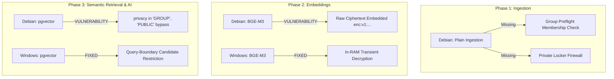

# MINDMESH — COMPLETE DEBIAN SERVER AUDIT, FILE MAPPING, DATABASE COMPATIBILITY & DEPLOYMENT READINESS REPORT

**Audit Date:** October 22, 2026  
**Auditor:** Principal Software Architect, Senior Debian/Linux Engineer, PostgreSQL/pgvector Architect & Application Security Auditor  
**Scope:** Complete Read-Only Technical Audit of Debian Server `10.9.11.238` vs. Windows Development Repository `F:\MindMesh-mindmesh-core\MindMesh-mindmesh-core`  
**Execution Environment:** Debian GNU/Linux 13 (trixie) x86_64 | Windows 10/11 x64  
**Primary Target Path on Debian:** `/home/coeai/mindmesh_copy`  
**Expected Working-Copy App Root:** `/home/coeai/mindmesh_copy/mindmesh`  
**Protected Original App Root:** `/home/coeai/mindmesh` (Strictly Untouched / Invariant Preserved)  
**Security Classification:** Strict Internal Technical Specification  

---

## 1. EXECUTIVE SUMMARY

A comprehensive, read-only architectural audit of the active Debian working copy (`/home/coeai/mindmesh_copy`) was conducted and compared against the Windows development workspace (`F:\MindMesh-mindmesh-core\MindMesh-mindmesh-core`).

### Key Findings:
1. **System & Isolation Integrity:** The Debian host runs Debian GNU/Linux 13 (trixie) with Linux kernel 6.12.73, Python 3.13.15, Node.js v20.20.0, and user-space PostgreSQL 18.6 with pgvector 0.8.6. The working-copy application (`/home/coeai/mindmesh_copy/mindmesh`) is strictly decoupled from the protected original (`/home/coeai/mindmesh`). The protected original application is currently completely inactive, untouched, and unpolluted.
2. **Directory & Process Topology Discovery:** The running FastAPI backend (PID 12845) on port `8001` has its current working directory (CWD) set to `/home/coeai/mindmesh_copy/mindmesh/backend/phase1_text_to_json_ingestion`. It was launched using a dedicated runner (`run_mindmesh_copy.py`), which prioritizes `backend/phase1_text_to_json_ingestion` as candidate path 0. The Windows workspace places backend files directly under `backend/app/`. This directory layout discrepancy is a critical structural finding that dictates exact deployment destinations.
3. **Package A (Private Locker Fixes) Status:** The 7 Package A files staged on Windows (fixing login crash BUG-01, locker status BUG-02, Phase 2 in-memory transient decryption BUG-03, and automated security assertions) are **NOT DEPLOYED** on Debian. The active server continues to run vulnerable code (missing optional user fields, legacy status response, and embedding ciphertexts directly).
4. **Package B (Local-First Architecture) Status:** Experimental local-first modules, `/api/v2/` routes, mobile encryption modules, and the dedicated `mindmesh_locker_auth` database are **NOT DEPLOYED** on Debian.
5. **Groups & ACL Status:** The complete Groups, 5-role RBAC, resource-level ACL, feed filtering, collaborative comments, and isolated semantic retrieval subsystem implemented and tested on Windows is **NOT DEPLOYED** on Debian. The live Debian backend contains critical Information Disclosure vulnerabilities (feed IDOR and cross-group semantic search leakage).
6. **Critical Database Migration Runner Hazard:** On Debian, `runner.py` uses `sorted(migrations_dir.glob("*.sql"))`. Because `003_rollback_auth_and_locker.sql` resides in the directory and lexicographically sorts after `003_auth_and_locker.sql`, executing the Debian migration runner would immediately execute the rollback SQL, dropping Private Locker tables and columns on live PostgreSQL! Windows code resolves this hazard via `get_forward_migration_files`, filtering out rollback scripts and tracking applied migrations in `schema_migrations`.
7. **Process Management Realities:** There is NO systemd unit named `mindmesh-backend.service` on the Debian server. The backend runs as a background process managed by `run_mindmesh_copy.py`. Naive execution of systemctl restart commands would fail.

---

## 2. ACTUAL SERVER ENVIRONMENT

All values below were gathered live via direct read-only inspection commands over SSH (`coeai@10.9.11.238`):

| Parameter | Server Value | Verification Method |
| :--- | :--- | :--- |
| **Hostname** | `debian` | `hostname` |
| **Remote User** | `coeai` (UID 1000, GID 1000) | `whoami && id` |
| **Operating System** | `Debian GNU/Linux 13 (trixie)` (Version 13.3) | `/etc/os-release` |
| **Linux Kernel** | `6.12.73+deb13-amd64 #1 SMP PREEMPT_DYNAMIC` | `uname -a` |
| **System Architecture**| `x86_64` (64-bit AMD/Intel) | `uname -m` |
| **System Memory (RAM)** | Total: `7844 MiB` (~8 GB), Used: `1349 MiB`, Free/Available: `6495 MiB` | `free -m` |
| **Swap Space** | Total: `8088 MiB`, Used: `0 MiB` | `free -m` |
| **Root Disk Storage** | Filesystem `/dev/sda2`: Total `908 GB`, Used `44 GB`, Available `818 GB` (6% used) | `df -h /` |
| **System Python** | `Python 3.13.5` (`/usr/bin/python3`) | `/usr/bin/python3 --version` |
| **Working-Copy Python**| `Python 3.13.15` (`/home/coeai/mindmesh_copy/mindmesh/environments/mindmesh/bin/python`) | `python --version` |
| **Node.js** | `v20.20.0` (`/usr/bin/node`) | `node --version` |
| **npm** | `10.8.2` (`/usr/bin/npm`) | `npm --version` |
| **PostgreSQL Binary** | `PostgreSQL 18.6` (`/home/coeai/mindmesh_copy/mindmesh/postgres/bin/postgres`) | `postgres --version` |
| **PostgreSQL psql** | `psql (PostgreSQL) 18.6` (`/home/coeai/mindmesh_copy/mindmesh/postgres/bin/psql`) | `psql --version` |
| **pgvector Extension**| `0.8.6` (Installed in PostgreSQL `mindmesh_copy`) | SQL query `\dx` |
| **Python pgvector** | `0.5.1` (Installed in working-copy venv) | `pip list` |
| **Python CUDA/Torch** | `torch 2.14.0`, `cuda-toolkit 13.0.3.0`, `sentence-transformers 6.1.0` | `pip list` |

---

## 3. RUNNING PROCESS AND SERVICE INVENTORY

### 3.1. Active Processes
| PID | User | Command Line | Ports / Sockets | Working Directory (CWD) | Role |
| :---: | :---: | :--- | :---: | :--- | :--- |
| **12845** | `coeai` | `/home/coeai/mindmesh_copy/mindmesh/environments/mindmesh/bin/python -m uvicorn app.main:app --host 0.0.0.0 --port 8001 --log-level info` | `0.0.0.0:8001` (TCP) | `/home/coeai/mindmesh_copy/mindmesh/backend/phase1_text_to_json_ingestion` | **Working-Copy FastAPI Backend** |
| **9256** | `coeai` | `/home/coeai/mindmesh_copy/mindmesh/postgres/bin/postgres -D /home/coeai/mindmesh_copy/mindmesh/data/postgres` | `127.0.0.1:5432`<br>`[::1]:5432` (TCP) | `/home/coeai` | **Working-Copy PostgreSQL 18.6 Database** |
| **886** | `root` | `/home/coeai/API_Server/venv/bin/gunicorn serverllmapi:app -w 4 -k uvicorn.workers.UvicornWorker --bind 0.0.0.0:8000 --timeout 600` | `0.0.0.0:8000` (TCP) | `/home/coeai/API_Server` | External LLM API Gateway (Root process) |
| - | - | Ollama Server | `127.0.0.1:11434`<br>`[::1]:11434` (TCP) | - | Local LLM inference engine |
| - | - | Metro Bundler | *None* | *None* | **Not Running** |

### 3.2. Process Analysis & Isolation Assessment
1. **Application Root Discovery:**
   PID 12845 is launched with working directory `/home/coeai/mindmesh_copy/mindmesh/backend/phase1_text_to_json_ingestion`. Its environment variable `DATABASE_URL` is set to `postgresql+asyncpg://coeai@localhost:5432/mindmesh_copy`.
2. **Process Management Reality:**
   Neither PID 12845 nor PID 9256 is governed by a systemd service unit.
   `systemctl status mindmesh-backend` returns: `Unit mindmesh-backend.service could not be found`.
   They are daemonized user processes (PPID 1).
3. **Protected Original Application Status:**
   `/home/coeai/mindmesh` has ZERO running processes. No process holds files or locks within `/home/coeai/mindmesh`. Restarting or modifying `/home/coeai/mindmesh_copy` will have **zero physical impact** on `/home/coeai/mindmesh`.

---

## 4. ACTUAL DIRECTORY STRUCTURE

Direct recursive audit of `/home/coeai/mindmesh_copy` yielded the following topology:

```text
/home/coeai/mindmesh_copy/
├── backups/                                    # Timestamped working-copy snapshots
├── data/                                       # Top-level shared data directory
├── environments/                               # Legacy root venvs
├── staging_windows_20261021/                   # Old Windows staging upload from Oct 21 05:46
└── mindmesh/                                   # ACTIVE WORKING-COPY APPLICATION ROOT
    ├── backend/
    │   └── phase1_text_to_json_ingestion/      # ACTIVE RUNNING BACKEND ROOT
    │       ├── app/
    │       │   ├── api/
    │       │   │   ├── dependencies/ (auth.py)
    │       │   │   └── routes/ (auth.py, locker.py, media.py, memories.py)
    │       │   ├── core/ (enums.py, errors.py, logging.py)
    │       │   ├── database/
    │       │   │   ├── connection/ (session.py)
    │       │   │   ├── migrations/ (001, 002, 003, 003_rollback, runner.py)
    │       │   │   ├── models/ (base.py, locker.py, phase1_output.py, phase2_embedding.py, raw_input.py, user.py)
    │       │   │   └── repositories/ (base.py, phase1_output_repo.py, phase2_embedding_repo.py, raw_input_repo.py)
    │       │   ├── orchestration/ (orchestrator.py)
    │       │   ├── prompts/
    │       │   ├── schemas/ (canonical_input.py, extraction_output.py, ingestion_request.py, memory_output.py, phase2_schemas.py, search_schemas.py, validation.py)
    │       │   ├── services/ (audio_processor, canonical_builder, crypto_service, embedding_service, image_processor, ingestion_service, llm_service, locker_service, memory_assembler, memory_search_service, phase2_service, text_processor, transcript_normalizer, validation_service, whisper_service)
    │       │   ├── storage/ (file_storage.py, memory_repository.py)
    │       │   ├── tools/
    │       │   ├── config.py
    │       │   └── main.py
    │       ├── media_uploads/ (audio/, images/)
    │       ├── pyproject.toml
    │       └── tests/ (18 test files)
    ├── backups/
    ├── data/
    │   └── postgres/                           # ACTIVE POSTGRES DATA DIRECTORY
    ├── environments/
    │   └── mindmesh/                           # DEDICATED PYTHON 3.13 VIRTUALENV
    ├── Logs/
    │   ├── backend_copy.log                    # Working-copy uvicorn log
    │   └── postgres_copy.log                   # Working-copy postgres log
    ├── micromamba/
    ├── mindmesh-mobile/                        # REACT NATIVE / EXPO MOBILE CLIENT
    │   ├── assets/
    │   ├── node_modules/ (317 packages)
    │   ├── src/
    │   │   ├── auth/ (AuthContext.tsx, authService.ts, authStorage.ts, authTypes.ts)
    │   │   ├── components/ (FloatingBottomDock.tsx, MindMeshLogo.tsx)
    │   │   ├── config/ (apiConfig.ts -> 10.9.11.238:8001)
    │   │   ├── screens/ (Composer, ForgotPassword, Home, Locker, Login, MemoryDetail, SignUp, Vault, Welcome)
    │   │   ├── services/ (apiClient.ts, memoryAdapter.ts)
    │   │   └── types/ (index.ts)
    │   ├── .env (EXPO_PUBLIC_API_URL=http://10.9.11.238:8001)
    │   ├── .env.example
    │   ├── App.tsx
    │   ├── app.json
    │   ├── package.json
    │   ├── package-lock.json
    │   └── tsconfig.json
    ├── postgres/                               # POSTGRESQL 18.6 RUNTIME BINARIES
    │   └── bin/ (postgres, psql, pg_ctl, createdb, dropdb, etc.)
    ├── run_mindmesh_copy.py                    # DEDICATED PLATFORM LAUNCHER
    └── run_mindmesh.py
```

---

## 5. WINDOWS VS DEBIAN FILE COMPARISON

### 5.1. Summary Breakdown
- **Windows Tracked Files:** 168
- **Debian Tracked Files:** 123
- **Exact Hash Matches:** 92 files
- **Windows Newer (Modified on Windows):** 27 files
- **Missing on Debian (New Files on Windows):** 47 files
- **Server-Specific Differences:** 2 files (`mindmesh-mobile/src/config/apiConfig.ts`, `run_mindmesh_copy.py`)
- **Debian Only Files:** 2 files (`image_evaluation_results.json`, `run_mindmesh.py`)

### 5.2. Complete Mapping Matrix (168 Files)
| Windows Source | Debian Destination | Exists? | SHA-256 Match? | Classification | Functional Difference | Action Required |
| :--- | :--- | :---: | :---: | :--- | :--- | :--- |
| `App.tsx` | `App.tsx` | No | No | **MISSING ON DEBIAN** | New project documentation or configuration. | Stage for reference. |
| `DEBIAN_DEPLOYMENT_MANIFEST.md` | `DEBIAN_DEPLOYMENT_MANIFEST.md` | No | No | **MISSING ON DEBIAN** | New project documentation or configuration. | Stage for reference. |
| `DEBIAN_SERVER_INTEGRATION_PLAN.md` | `DEBIAN_SERVER_INTEGRATION_PLAN.md` | No | No | **MISSING ON DEBIAN** | New project documentation or configuration. | Stage for reference. |
| `GROUPS_ACL_COMPLETE_IMPLEMENTATION_BLUEPRINT.md` | `GROUPS_ACL_COMPLETE_IMPLEMENTATION_BLUEPRINT.md` | No | No | **MISSING ON DEBIAN** | New project documentation or configuration. | Stage for reference. |
| `GROUPS_ACL_DEPLOYMENT_MANIFEST.md` | `GROUPS_ACL_DEPLOYMENT_MANIFEST.md` | No | No | **MISSING ON DEBIAN** | New project documentation or configuration. | Stage for reference. |
| `GROUPS_ACL_IMPLEMENTATION_REPORT.md` | `GROUPS_ACL_IMPLEMENTATION_REPORT.md` | No | No | **MISSING ON DEBIAN** | New project documentation or configuration. | Stage for reference. |
| `GROUPS_ACL_SECURITY_TEST_REPORT.md` | `GROUPS_ACL_SECURITY_TEST_REPORT.md` | No | No | **MISSING ON DEBIAN** | New project documentation or configuration. | Stage for reference. |
| `LOCAL_FIRST_PRIVATE_LOCKER_PROGRESS.md` | `LOCAL_FIRST_PRIVATE_LOCKER_PROGRESS.md` | No | No | **MISSING ON DEBIAN** | New project documentation or configuration. | Stage for reference. |
| `PRIVATE_LOCKER_INTEGRATION_ACCURACY_AUDIT.md` | `PRIVATE_LOCKER_INTEGRATION_ACCURACY_AUDIT.md` | No | No | **MISSING ON DEBIAN** | New project documentation or configuration. | Stage for reference. |
| `STABLE_PRIVATE_LOCKER_FIX_REPORT.md` | `STABLE_PRIVATE_LOCKER_FIX_REPORT.md` | No | No | **MISSING ON DEBIAN** | New project documentation or configuration. | Stage for reference. |
| `apiConfig.ts` | `apiConfig.ts` | No | No | **MISSING ON DEBIAN** | New project documentation or configuration. | Stage for reference. |
| `backend/.env.example` | `backend/.env.example` | No | No | **MISSING ON DEBIAN** | New project documentation or configuration. | Stage for reference. |
| `backend/app/__init__.py` | `backend/phase1_text_to_json_ingestion/app/__init__.py` | Yes | Yes | **EXACT MATCH** | Identical checksum and file length. | Preserve existing file. No action needed. |
| `backend/app/api/__init__.py` | `backend/phase1_text_to_json_ingestion/app/api/__init__.py` | Yes | Yes | **EXACT MATCH** | Identical checksum and file length. | Preserve existing file. No action needed. |
| `backend/app/api/dependencies/auth.py` | `backend/phase1_text_to_json_ingestion/app/api/dependencies/auth.py` | Yes | Yes | **EXACT MATCH** | Identical checksum and file length. | Preserve existing file. No action needed. |
| `backend/app/api/routes/__init__.py` | `backend/phase1_text_to_json_ingestion/app/api/routes/__init__.py` | Yes | Yes | **EXACT MATCH** | Identical checksum and file length. | Preserve existing file. No action needed. |
| `backend/app/api/routes/auth.py` | `backend/phase1_text_to_json_ingestion/app/api/routes/auth.py` | Yes | No | **WINDOWS NEWER** | Adds email and full_name optional fields to UserResponse (fixes BUG-01). | Stage & deploy to active backend routes. |
| `backend/app/api/routes/comments.py` | `backend/phase1_text_to_json_ingestion/app/api/routes/comments.py` | No | No | **MISSING ON DEBIAN** | FastAPI endpoints for collaborative comments & knowledge eligibility. | Deploy to backend routes. |
| `backend/app/api/routes/groups.py` | `backend/phase1_text_to_json_ingestion/app/api/routes/groups.py` | No | No | **MISSING ON DEBIAN** | FastAPI endpoints for Group CRUD, members, invitations, ownership. | Deploy to backend routes. |
| `backend/app/api/routes/locker.py` | `backend/phase1_text_to_json_ingestion/app/api/routes/locker.py` | Yes | No | **WINDOWS NEWER** | Adds dual-format exists/status response contract (fixes BUG-02). | Stage & deploy to active backend routes. |
| `backend/app/api/routes/media.py` | `backend/phase1_text_to_json_ingestion/app/api/routes/media.py` | Yes | No | **WINDOWS NEWER** | Adds ACL membership check for shared group media streaming. | Deploy to backend routes. |
| `backend/app/api/routes/memories.py` | `backend/phase1_text_to_json_ingestion/app/api/routes/memories.py` | Yes | No | **WINDOWS NEWER** | Adds group validation on ingest, feed membership check, share/revoke routes. | Deploy to backend routes. |
| `backend/app/config.py` | `backend/phase1_text_to_json_ingestion/app/config.py` | Yes | Yes | **EXACT MATCH** | Identical checksum and file length. | Preserve existing file. No action needed. |
| `backend/app/core/__init__.py` | `backend/phase1_text_to_json_ingestion/app/core/__init__.py` | Yes | Yes | **EXACT MATCH** | Identical checksum and file length. | Preserve existing file. No action needed. |
| `backend/app/core/enums.py` | `backend/phase1_text_to_json_ingestion/app/core/enums.py` | Yes | No | **WINDOWS NEWER** | Harmonizes Privacy enum (SHARED, PUBLIC, legacy), adds GroupRole, InvitationStatus. | Deploy to backend core. |
| `backend/app/core/errors.py` | `backend/phase1_text_to_json_ingestion/app/core/errors.py` | Yes | Yes | **EXACT MATCH** | Identical checksum and file length. | Preserve existing file. No action needed. |
| `backend/app/core/logging.py` | `backend/phase1_text_to_json_ingestion/app/core/logging.py` | Yes | Yes | **EXACT MATCH** | Identical checksum and file length. | Preserve existing file. No action needed. |
| `backend/app/database/__init__.py` | `backend/phase1_text_to_json_ingestion/app/database/__init__.py` | Yes | Yes | **EXACT MATCH** | Identical checksum and file length. | Preserve existing file. No action needed. |
| `backend/app/database/connection/__init__.py` | `backend/phase1_text_to_json_ingestion/app/database/connection/__init__.py` | Yes | Yes | **EXACT MATCH** | Identical checksum and file length. | Preserve existing file. No action needed. |
| `backend/app/database/connection/session.py` | `backend/phase1_text_to_json_ingestion/app/database/connection/session.py` | Yes | Yes | **EXACT MATCH** | Identical checksum and file length. | Preserve existing file. No action needed. |
| `backend/app/database/migrations/001_initial_schema.sql` | `backend/phase1_text_to_json_ingestion/app/database/migrations/001_initial_schema.sql` | Yes | Yes | **EXACT MATCH** | Identical checksum and file length. | Preserve existing file. No action needed. |
| `backend/app/database/migrations/002_phase2_schema.sql` | `backend/phase1_text_to_json_ingestion/app/database/migrations/002_phase2_schema.sql` | Yes | Yes | **EXACT MATCH** | Identical checksum and file length. | Preserve existing file. No action needed. |
| `backend/app/database/migrations/003_auth_and_locker.sql` | `backend/phase1_text_to_json_ingestion/app/database/migrations/003_auth_and_locker.sql` | Yes | Yes | **EXACT MATCH** | Identical checksum and file length. | Preserve existing file. No action needed. |
| `backend/app/database/migrations/003_rollback_auth_and_locker.sql` | `backend/phase1_text_to_json_ingestion/app/database/migrations/003_rollback_auth_and_locker.sql` | Yes | Yes | **EXACT MATCH** | Identical checksum and file length. | Preserve existing file. No action needed. |
| `backend/app/database/migrations/004_groups_and_acl.sql` | `backend/phase1_text_to_json_ingestion/app/database/migrations/004_groups_and_acl.sql` | No | No | **MISSING ON DEBIAN** | Database migration for groups, memberships, invitations, ACL, comments. | Deploy to migrations folder and execute via runner. |
| `backend/app/database/migrations/004_rollback_groups_and_acl.sql` | `backend/phase1_text_to_json_ingestion/app/database/migrations/004_rollback_groups_and_acl.sql` | No | No | **MISSING ON DEBIAN** | Rollback migration for groups. | Deploy to migrations folder. |
| `backend/app/database/migrations/__init__.py` | `backend/phase1_text_to_json_ingestion/app/database/migrations/__init__.py` | Yes | Yes | **EXACT MATCH** | Identical checksum and file length. | Preserve existing file. No action needed. |
| `backend/app/database/migrations/runner.py` | `backend/phase1_text_to_json_ingestion/app/database/migrations/runner.py` | Yes | No | **WINDOWS NEWER** | Filters out *rollback*.sql files and tracks schema_migrations table. | CRITICAL: Deploy immediately before running any migrations. |
| `backend/app/database/models/__init__.py` | `backend/phase1_text_to_json_ingestion/app/database/models/__init__.py` | Yes | No | **WINDOWS NEWER** | Exports GroupModel, GroupMemberModel, CommentModel, etc. | Deploy to database models. |
| `backend/app/database/models/base.py` | `backend/phase1_text_to_json_ingestion/app/database/models/base.py` | Yes | Yes | **EXACT MATCH** | Identical checksum and file length. | Preserve existing file. No action needed. |
| `backend/app/database/models/comments.py` | `backend/phase1_text_to_json_ingestion/app/database/models/comments.py` | No | No | **MISSING ON DEBIAN** | SQLAlchemy model for memory_comments. | Deploy to database models. |
| `backend/app/database/models/groups.py` | `backend/phase1_text_to_json_ingestion/app/database/models/groups.py` | No | No | **MISSING ON DEBIAN** | SQLAlchemy models for groups, group_members, group_invitations, etc. | Deploy to database models. |
| `backend/app/database/models/locker.py` | `backend/phase1_text_to_json_ingestion/app/database/models/locker.py` | Yes | Yes | **EXACT MATCH** | Identical checksum and file length. | Preserve existing file. No action needed. |
| `backend/app/database/models/phase1_output.py` | `backend/phase1_text_to_json_ingestion/app/database/models/phase1_output.py` | Yes | Yes | **EXACT MATCH** | Identical checksum and file length. | Preserve existing file. No action needed. |
| `backend/app/database/models/phase2_embedding.py` | `backend/phase1_text_to_json_ingestion/app/database/models/phase2_embedding.py` | Yes | Yes | **EXACT MATCH** | Identical checksum and file length. | Preserve existing file. No action needed. |
| `backend/app/database/models/raw_input.py` | `backend/phase1_text_to_json_ingestion/app/database/models/raw_input.py` | Yes | Yes | **EXACT MATCH** | Identical checksum and file length. | Preserve existing file. No action needed. |
| `backend/app/database/models/user.py` | `backend/phase1_text_to_json_ingestion/app/database/models/user.py` | Yes | Yes | **EXACT MATCH** | Identical checksum and file length. | Preserve existing file. No action needed. |
| `backend/app/database/repositories/__init__.py` | `backend/phase1_text_to_json_ingestion/app/database/repositories/__init__.py` | Yes | Yes | **EXACT MATCH** | Identical checksum and file length. | Preserve existing file. No action needed. |
| `backend/app/database/repositories/base.py` | `backend/phase1_text_to_json_ingestion/app/database/repositories/base.py` | Yes | Yes | **EXACT MATCH** | Identical checksum and file length. | Preserve existing file. No action needed. |
| `backend/app/database/repositories/phase1_output_repo.py` | `backend/phase1_text_to_json_ingestion/app/database/repositories/phase1_output_repo.py` | Yes | Yes | **EXACT MATCH** | Identical checksum and file length. | Preserve existing file. No action needed. |
| `backend/app/database/repositories/phase2_embedding_repo.py` | `backend/phase1_text_to_json_ingestion/app/database/repositories/phase2_embedding_repo.py` | Yes | No | **WINDOWS NEWER** | Adds find_by_ids for candidate filtering. | Deploy to backend repositories. |
| `backend/app/database/repositories/raw_input_repo.py` | `backend/phase1_text_to_json_ingestion/app/database/repositories/raw_input_repo.py` | Yes | Yes | **EXACT MATCH** | Identical checksum and file length. | Preserve existing file. No action needed. |
| `backend/app/local_first/__init__.py` | `backend/phase1_text_to_json_ingestion/app/local_first/__init__.py` | No | No | **MISSING ON DEBIAN** | Package B local-first experimental module (routes, models, crypto, storage). | Stage under local_first; leave unmounted/unactivated until approved. |
| `backend/app/local_first/database.py` | `backend/phase1_text_to_json_ingestion/app/local_first/database.py` | No | No | **MISSING ON DEBIAN** | Package B local-first experimental module (routes, models, crypto, storage). | Stage under local_first; leave unmounted/unactivated until approved. |
| `backend/app/local_first/migrations/001_locker_auth_init.sql` | `backend/phase1_text_to_json_ingestion/app/local_first/migrations/001_locker_auth_init.sql` | No | No | **MISSING ON DEBIAN** | Package B local-first experimental module (routes, models, crypto, storage). | Stage under local_first; leave unmounted/unactivated until approved. |
| `backend/app/local_first/migrations/001_locker_auth_rollback.sql` | `backend/phase1_text_to_json_ingestion/app/local_first/migrations/001_locker_auth_rollback.sql` | No | No | **MISSING ON DEBIAN** | Package B local-first experimental module (routes, models, crypto, storage). | Stage under local_first; leave unmounted/unactivated until approved. |
| `backend/app/local_first/models.py` | `backend/phase1_text_to_json_ingestion/app/local_first/models.py` | No | No | **MISSING ON DEBIAN** | Package B local-first experimental module (routes, models, crypto, storage). | Stage under local_first; leave unmounted/unactivated until approved. |
| `backend/app/local_first/repository.py` | `backend/phase1_text_to_json_ingestion/app/local_first/repository.py` | No | No | **MISSING ON DEBIAN** | Package B local-first experimental module (routes, models, crypto, storage). | Stage under local_first; leave unmounted/unactivated until approved. |
| `backend/app/local_first/routes.py` | `backend/phase1_text_to_json_ingestion/app/local_first/routes.py` | No | No | **MISSING ON DEBIAN** | Package B local-first experimental module (routes, models, crypto, storage). | Stage under local_first; leave unmounted/unactivated until approved. |
| `backend/app/local_first/schemas.py` | `backend/phase1_text_to_json_ingestion/app/local_first/schemas.py` | No | No | **MISSING ON DEBIAN** | Package B local-first experimental module (routes, models, crypto, storage). | Stage under local_first; leave unmounted/unactivated until approved. |
| `backend/app/local_first/service.py` | `backend/phase1_text_to_json_ingestion/app/local_first/service.py` | No | No | **MISSING ON DEBIAN** | Package B local-first experimental module (routes, models, crypto, storage). | Stage under local_first; leave unmounted/unactivated until approved. |
| `backend/app/local_first/temporary_processing.py` | `backend/phase1_text_to_json_ingestion/app/local_first/temporary_processing.py` | No | No | **MISSING ON DEBIAN** | Package B local-first experimental module (routes, models, crypto, storage). | Stage under local_first; leave unmounted/unactivated until approved. |
| `backend/app/main.py` | `backend/phase1_text_to_json_ingestion/app/main.py` | Yes | No | **WINDOWS NEWER** | Mounts groups and comments routers. | Deploy to backend app root. |
| `backend/app/orchestration/__init__.py` | `backend/phase1_text_to_json_ingestion/app/orchestration/__init__.py` | Yes | Yes | **EXACT MATCH** | Identical checksum and file length. | Preserve existing file. No action needed. |
| `backend/app/orchestration/orchestrator.py` | `backend/phase1_text_to_json_ingestion/app/orchestration/orchestrator.py` | Yes | Yes | **EXACT MATCH** | Identical checksum and file length. | Preserve existing file. No action needed. |
| `backend/app/prompts/memory_extraction_system.md` | `backend/phase1_text_to_json_ingestion/app/prompts/memory_extraction_system.md` | Yes | Yes | **EXACT MATCH** | Identical checksum and file length. | Preserve existing file. No action needed. |
| `backend/app/prompts/memory_extraction_user_template.md` | `backend/phase1_text_to_json_ingestion/app/prompts/memory_extraction_user_template.md` | Yes | Yes | **EXACT MATCH** | Identical checksum and file length. | Preserve existing file. No action needed. |
| `backend/app/schemas/__init__.py` | `backend/phase1_text_to_json_ingestion/app/schemas/__init__.py` | Yes | Yes | **EXACT MATCH** | Identical checksum and file length. | Preserve existing file. No action needed. |
| `backend/app/schemas/canonical_input.py` | `backend/phase1_text_to_json_ingestion/app/schemas/canonical_input.py` | Yes | Yes | **EXACT MATCH** | Identical checksum and file length. | Preserve existing file. No action needed. |
| `backend/app/schemas/comment.py` | `backend/phase1_text_to_json_ingestion/app/schemas/comment.py` | No | No | **MISSING ON DEBIAN** | Pydantic schemas for comments. | Deploy to backend schemas. |
| `backend/app/schemas/extraction_output.py` | `backend/phase1_text_to_json_ingestion/app/schemas/extraction_output.py` | Yes | Yes | **EXACT MATCH** | Identical checksum and file length. | Preserve existing file. No action needed. |
| `backend/app/schemas/group.py` | `backend/phase1_text_to_json_ingestion/app/schemas/group.py` | No | No | **MISSING ON DEBIAN** | Pydantic schemas for groups, members, invitations, shares. | Deploy to backend schemas. |
| `backend/app/schemas/ingestion_request.py` | `backend/phase1_text_to_json_ingestion/app/schemas/ingestion_request.py` | Yes | Yes | **EXACT MATCH** | Identical checksum and file length. | Preserve existing file. No action needed. |
| `backend/app/schemas/memory_output.py` | `backend/phase1_text_to_json_ingestion/app/schemas/memory_output.py` | Yes | Yes | **EXACT MATCH** | Identical checksum and file length. | Preserve existing file. No action needed. |
| `backend/app/schemas/phase2_schemas.py` | `backend/phase1_text_to_json_ingestion/app/schemas/phase2_schemas.py` | Yes | Yes | **EXACT MATCH** | Identical checksum and file length. | Preserve existing file. No action needed. |
| `backend/app/schemas/search_schemas.py` | `backend/phase1_text_to_json_ingestion/app/schemas/search_schemas.py` | Yes | No | **WINDOWS NEWER** | Adds group_id query parameter. | Deploy to backend schemas. |
| `backend/app/schemas/validation.py` | `backend/phase1_text_to_json_ingestion/app/schemas/validation.py` | Yes | Yes | **EXACT MATCH** | Identical checksum and file length. | Preserve existing file. No action needed. |
| `backend/app/services/__init__.py` | `backend/phase1_text_to_json_ingestion/app/services/__init__.py` | Yes | Yes | **EXACT MATCH** | Identical checksum and file length. | Preserve existing file. No action needed. |
| `backend/app/services/audio_processor.py` | `backend/phase1_text_to_json_ingestion/app/services/audio_processor.py` | Yes | Yes | **EXACT MATCH** | Identical checksum and file length. | Preserve existing file. No action needed. |
| `backend/app/services/auth_service.py` | `backend/phase1_text_to_json_ingestion/app/services/auth_service.py` | Yes | Yes | **EXACT MATCH** | Identical checksum and file length. | Preserve existing file. No action needed. |
| `backend/app/services/authz_service.py` | `backend/phase1_text_to_json_ingestion/app/services/authz_service.py` | Yes | No | **WINDOWS NEWER** | Full 5-role RBAC, query-boundary candidate restriction, Private Locker firewall. | Deploy to backend services. |
| `backend/app/services/canonical_builder.py` | `backend/phase1_text_to_json_ingestion/app/services/canonical_builder.py` | Yes | Yes | **EXACT MATCH** | Identical checksum and file length. | Preserve existing file. No action needed. |
| `backend/app/services/comment_service.py` | `backend/phase1_text_to_json_ingestion/app/services/comment_service.py` | No | No | **MISSING ON DEBIAN** | Comment service with substantive knowledge eligibility analysis. | Deploy to backend services. |
| `backend/app/services/crypto_service.py` | `backend/phase1_text_to_json_ingestion/app/services/crypto_service.py` | Yes | Yes | **EXACT MATCH** | Identical checksum and file length. | Preserve existing file. No action needed. |
| `backend/app/services/embedding_service.py` | `backend/phase1_text_to_json_ingestion/app/services/embedding_service.py` | Yes | Yes | **EXACT MATCH** | Identical checksum and file length. | Preserve existing file. No action needed. |
| `backend/app/services/group_service.py` | `backend/phase1_text_to_json_ingestion/app/services/group_service.py` | No | No | **MISSING ON DEBIAN** | Group lifecycle, invitations, 5-role RBAC enforcement. | Deploy to backend services. |
| `backend/app/services/image_processor.py` | `backend/phase1_text_to_json_ingestion/app/services/image_processor.py` | Yes | Yes | **EXACT MATCH** | Identical checksum and file length. | Preserve existing file. No action needed. |
| `backend/app/services/ingestion_service.py` | `backend/phase1_text_to_json_ingestion/app/services/ingestion_service.py` | Yes | Yes | **EXACT MATCH** | Identical checksum and file length. | Preserve existing file. No action needed. |
| `backend/app/services/llm_service.py` | `backend/phase1_text_to_json_ingestion/app/services/llm_service.py` | Yes | Yes | **EXACT MATCH** | Identical checksum and file length. | Preserve existing file. No action needed. |
| `backend/app/services/locker_service.py` | `backend/phase1_text_to_json_ingestion/app/services/locker_service.py` | Yes | No | **WINDOWS NEWER** | Adds validate_locker_session alias for API compatibility. | Stage & deploy to active backend services. |
| `backend/app/services/memory_assembler.py` | `backend/phase1_text_to_json_ingestion/app/services/memory_assembler.py` | Yes | Yes | **EXACT MATCH** | Identical checksum and file length. | Preserve existing file. No action needed. |
| `backend/app/services/memory_search_service.py` | `backend/phase1_text_to_json_ingestion/app/services/memory_search_service.py` | Yes | No | **WINDOWS NEWER** | Eliminates ('GROUP', 'PUBLIC') bypass, enforces query-boundary ACL. | Deploy to backend services. |
| `backend/app/services/phase2_service.py` | `backend/phase1_text_to_json_ingestion/app/services/phase2_service.py` | Yes | No | **WINDOWS NEWER** | Adds transient in-memory decryption for BGE-M3 (fixes BUG-03). | Stage & deploy to active backend services. |
| `backend/app/services/share_service.py` | `backend/phase1_text_to_json_ingestion/app/services/share_service.py` | No | No | **MISSING ON DEBIAN** | Resource sharing, multi-group access, direct user ACL, Private Locker guard. | Deploy to backend services. |
| `backend/app/services/text_processor.py` | `backend/phase1_text_to_json_ingestion/app/services/text_processor.py` | Yes | Yes | **EXACT MATCH** | Identical checksum and file length. | Preserve existing file. No action needed. |
| `backend/app/services/transcript_normalizer.py` | `backend/phase1_text_to_json_ingestion/app/services/transcript_normalizer.py` | Yes | Yes | **EXACT MATCH** | Identical checksum and file length. | Preserve existing file. No action needed. |
| `backend/app/services/validation_service.py` | `backend/phase1_text_to_json_ingestion/app/services/validation_service.py` | Yes | Yes | **EXACT MATCH** | Identical checksum and file length. | Preserve existing file. No action needed. |
| `backend/app/services/whisper_service.py` | `backend/phase1_text_to_json_ingestion/app/services/whisper_service.py` | Yes | Yes | **EXACT MATCH** | Identical checksum and file length. | Preserve existing file. No action needed. |
| `backend/app/storage/__init__.py` | `backend/phase1_text_to_json_ingestion/app/storage/__init__.py` | Yes | Yes | **EXACT MATCH** | Identical checksum and file length. | Preserve existing file. No action needed. |
| `backend/app/storage/file_storage.py` | `backend/phase1_text_to_json_ingestion/app/storage/file_storage.py` | Yes | Yes | **EXACT MATCH** | Identical checksum and file length. | Preserve existing file. No action needed. |
| `backend/app/storage/memory_repository.py` | `backend/phase1_text_to_json_ingestion/app/storage/memory_repository.py` | Yes | Yes | **EXACT MATCH** | Identical checksum and file length. | Preserve existing file. No action needed. |
| `backend/app/tools/__init__.py` | `backend/phase1_text_to_json_ingestion/app/tools/__init__.py` | Yes | Yes | **EXACT MATCH** | Identical checksum and file length. | Preserve existing file. No action needed. |
| `backend/app/tools/dataset_audit.py` | `backend/phase1_text_to_json_ingestion/app/tools/dataset_audit.py` | Yes | Yes | **EXACT MATCH** | Identical checksum and file length. | Preserve existing file. No action needed. |
| `backend/app/tools/dataset_ingest_missing.py` | `backend/phase1_text_to_json_ingestion/app/tools/dataset_ingest_missing.py` | Yes | Yes | **EXACT MATCH** | Identical checksum and file length. | Preserve existing file. No action needed. |
| `backend/app/tools/dataset_runner.py` | `backend/phase1_text_to_json_ingestion/app/tools/dataset_runner.py` | Yes | Yes | **EXACT MATCH** | Identical checksum and file length. | Preserve existing file. No action needed. |
| `backend/app/tools/phase2_index_dataset.py` | `backend/phase1_text_to_json_ingestion/app/tools/phase2_index_dataset.py` | Yes | Yes | **EXACT MATCH** | Identical checksum and file length. | Preserve existing file. No action needed. |
| `backend/dataset_evaluation_results.json` | `backend/phase1_text_to_json_ingestion/dataset_evaluation_results.json` | Yes | No | **WINDOWS NEWER** | Windows development updates. | Stage and deploy. |
| `backend/tests/conftest.py` | `backend/phase1_text_to_json_ingestion/tests/conftest.py` | Yes | Yes | **EXACT MATCH** | Identical checksum and file length. | Preserve existing file. No action needed. |
| `backend/tests/test_audio_ingestion.py` | `backend/phase1_text_to_json_ingestion/tests/test_audio_ingestion.py` | Yes | Yes | **EXACT MATCH** | Identical checksum and file length. | Preserve existing file. No action needed. |
| `backend/tests/test_file_storage.py` | `backend/phase1_text_to_json_ingestion/tests/test_file_storage.py` | Yes | Yes | **EXACT MATCH** | Identical checksum and file length. | Preserve existing file. No action needed. |
| `backend/tests/test_groups_api_routes.py` | `backend/phase1_text_to_json_ingestion/tests/test_groups_api_routes.py` | No | No | **MISSING ON DEBIAN** | Automated test suites for Groups lifecycle, API routes, and runner security. | Deploy to backend tests directory. |
| `backend/tests/test_groups_lifecycle_e2e.py` | `backend/phase1_text_to_json_ingestion/tests/test_groups_lifecycle_e2e.py` | No | No | **MISSING ON DEBIAN** | Automated test suites for Groups lifecycle, API routes, and runner security. | Deploy to backend tests directory. |
| `backend/tests/test_llm_response_repair.py` | `backend/phase1_text_to_json_ingestion/tests/test_llm_response_repair.py` | Yes | Yes | **EXACT MATCH** | Identical checksum and file length. | Preserve existing file. No action needed. |
| `backend/tests/test_local_first_auth.py` | `backend/phase1_text_to_json_ingestion/tests/test_local_first_auth.py` | No | No | **MISSING ON DEBIAN** | Package B local-first experimental module (routes, models, crypto, storage). | Stage under local_first; leave unmounted/unactivated until approved. |
| `backend/tests/test_locker.py` | `backend/phase1_text_to_json_ingestion/tests/test_locker.py` | Yes | Yes | **EXACT MATCH** | Identical checksum and file length. | Preserve existing file. No action needed. |
| `backend/tests/test_locker_22_security_audit.py` | `backend/phase1_text_to_json_ingestion/tests/test_locker_22_security_audit.py` | Yes | No | **WINDOWS NEWER** | Hardened automated assertions for Reqs 10, 17, 20, 21, 22. | Deploy to tests directory. |
| `backend/tests/test_media_api.py` | `backend/phase1_text_to_json_ingestion/tests/test_media_api.py` | Yes | Yes | **EXACT MATCH** | Identical checksum and file length. | Preserve existing file. No action needed. |
| `backend/tests/test_memory_api.py` | `backend/phase1_text_to_json_ingestion/tests/test_memory_api.py` | Yes | Yes | **EXACT MATCH** | Identical checksum and file length. | Preserve existing file. No action needed. |
| `backend/tests/test_migration_runner_security.py` | `backend/phase1_text_to_json_ingestion/tests/test_migration_runner_security.py` | No | No | **MISSING ON DEBIAN** | Automated test suites for Groups lifecycle, API routes, and runner security. | Deploy to backend tests directory. |
| `backend/tests/test_orchestration_flow.py` | `backend/phase1_text_to_json_ingestion/tests/test_orchestration_flow.py` | Yes | Yes | **EXACT MATCH** | Identical checksum and file length. | Preserve existing file. No action needed. |
| `backend/tests/test_phase1_outputs_persistence.py` | `backend/phase1_text_to_json_ingestion/tests/test_phase1_outputs_persistence.py` | Yes | Yes | **EXACT MATCH** | Identical checksum and file length. | Preserve existing file. No action needed. |
| `backend/tests/test_phase2_embeddings.py` | `backend/phase1_text_to_json_ingestion/tests/test_phase2_embeddings.py` | Yes | Yes | **EXACT MATCH** | Identical checksum and file length. | Preserve existing file. No action needed. |
| `backend/tests/test_raw_inputs_persistence.py` | `backend/phase1_text_to_json_ingestion/tests/test_raw_inputs_persistence.py` | Yes | Yes | **EXACT MATCH** | Identical checksum and file length. | Preserve existing file. No action needed. |
| `backend/tests/test_runner.py` | `backend/phase1_text_to_json_ingestion/tests/test_runner.py` | Yes | Yes | **EXACT MATCH** | Identical checksum and file length. | Preserve existing file. No action needed. |
| `backend/tests/test_schema_validation.py` | `backend/phase1_text_to_json_ingestion/tests/test_schema_validation.py` | Yes | Yes | **EXACT MATCH** | Identical checksum and file length. | Preserve existing file. No action needed. |
| `backend/tests/test_search_answer_persona.py` | `backend/phase1_text_to_json_ingestion/tests/test_search_answer_persona.py` | Yes | Yes | **EXACT MATCH** | Identical checksum and file length. | Preserve existing file. No action needed. |
| `backend/tests/test_text_ingestion.py` | `backend/phase1_text_to_json_ingestion/tests/test_text_ingestion.py` | Yes | Yes | **EXACT MATCH** | Identical checksum and file length. | Preserve existing file. No action needed. |
| `backend/tests/test_transcript_normalizer.py` | `backend/phase1_text_to_json_ingestion/tests/test_transcript_normalizer.py` | Yes | Yes | **EXACT MATCH** | Identical checksum and file length. | Preserve existing file. No action needed. |
| `backend/tests/verify_single_samples.py` | `backend/phase1_text_to_json_ingestion/tests/verify_single_samples.py` | Yes | Yes | **EXACT MATCH** | Identical checksum and file length. | Preserve existing file. No action needed. |
| `dataset_evaluation_results.json` | `dataset_evaluation_results.json` | Yes | No | **WINDOWS NEWER** | Windows development updates. | Stage and deploy. |
| `mindmesh-mobile/.env.example` | `mindmesh-mobile/.env.example` | Yes | No | **SERVER-SPECIFIC DIFFERENCE** | Environment or server configuration. | Review server-specific values. |
| `mindmesh-mobile/.expo/README.md` | `mindmesh-mobile/.expo/README.md` | No | No | **MISSING ON DEBIAN** | New project documentation or configuration. | Stage for reference. |
| `mindmesh-mobile/.expo/devices.json` | `mindmesh-mobile/.expo/devices.json` | No | No | **MISSING ON DEBIAN** | New project documentation or configuration. | Stage for reference. |
| `mindmesh-mobile/App.tsx` | `mindmesh-mobile/App.tsx` | Yes | No | **WINDOWS NEWER** | Mounts GroupsScreen and GroupDetailScreen in navigation flow. | Deploy to mobile root. |
| `mindmesh-mobile/app.json` | `mindmesh-mobile/app.json` | Yes | Yes | **EXACT MATCH** | Identical checksum and file length. | Preserve existing file. No action needed. |
| `mindmesh-mobile/eas.json` | `mindmesh-mobile/eas.json` | Yes | Yes | **EXACT MATCH** | Identical checksum and file length. | Preserve existing file. No action needed. |
| `mindmesh-mobile/index.ts` | `mindmesh-mobile/index.ts` | Yes | Yes | **EXACT MATCH** | Identical checksum and file length. | Preserve existing file. No action needed. |
| `mindmesh-mobile/package-lock.json` | `mindmesh-mobile/package-lock.json` | Yes | No | **WINDOWS NEWER** | Expo SDK package lock updates. | Deploy to mobile root. |
| `mindmesh-mobile/package.json` | `mindmesh-mobile/package.json` | Yes | No | **WINDOWS NEWER** | Expo SDK package lock updates. | Deploy to mobile root. |
| `mindmesh-mobile/src/auth/AuthContext.tsx` | `mindmesh-mobile/src/auth/AuthContext.tsx` | Yes | Yes | **EXACT MATCH** | Identical checksum and file length. | Preserve existing file. No action needed. |
| `mindmesh-mobile/src/auth/authService.ts` | `mindmesh-mobile/src/auth/authService.ts` | Yes | No | **WINDOWS NEWER** | Safe user display name fallback without unsafe split('@') (fixes BUG-01). | Deploy to mindmesh-mobile auth service. |
| `mindmesh-mobile/src/auth/authStorage.ts` | `mindmesh-mobile/src/auth/authStorage.ts` | Yes | Yes | **EXACT MATCH** | Identical checksum and file length. | Preserve existing file. No action needed. |
| `mindmesh-mobile/src/auth/authTypes.ts` | `mindmesh-mobile/src/auth/authTypes.ts` | Yes | Yes | **EXACT MATCH** | Identical checksum and file length. | Preserve existing file. No action needed. |
| `mindmesh-mobile/src/components/FloatingBottomDock.tsx` | `mindmesh-mobile/src/components/FloatingBottomDock.tsx` | Yes | No | **WINDOWS NEWER** | Adds Groups tab with cream/forest green theme. | Deploy to mobile components. |
| `mindmesh-mobile/src/components/MindMeshLogo.tsx` | `mindmesh-mobile/src/components/MindMeshLogo.tsx` | Yes | Yes | **EXACT MATCH** | Identical checksum and file length. | Preserve existing file. No action needed. |
| `mindmesh-mobile/src/config/apiConfig.ts` | `mindmesh-mobile/src/config/apiConfig.ts` | Yes | Yes | **EXACT MATCH** | Identical checksum and file length. | Preserve existing file. No action needed. |
| `mindmesh-mobile/src/local_first/ConsentGate.tsx` | `mindmesh-mobile/src/local_first/ConsentGate.tsx` | No | No | **MISSING ON DEBIAN** | Package B local-first experimental module (routes, models, crypto, storage). | Stage under local_first; leave unmounted/unactivated until approved. |
| `mindmesh-mobile/src/local_first/deviceKeyManager.ts` | `mindmesh-mobile/src/local_first/deviceKeyManager.ts` | No | No | **MISSING ON DEBIAN** | Package B local-first experimental module (routes, models, crypto, storage). | Stage under local_first; leave unmounted/unactivated until approved. |
| `mindmesh-mobile/src/local_first/localEncryptedStorage.ts` | `mindmesh-mobile/src/local_first/localEncryptedStorage.ts` | No | No | **MISSING ON DEBIAN** | Package B local-first experimental module (routes, models, crypto, storage). | Stage under local_first; leave unmounted/unactivated until approved. |
| `mindmesh-mobile/src/local_first/localFirstAdapter.ts` | `mindmesh-mobile/src/local_first/localFirstAdapter.ts` | No | No | **MISSING ON DEBIAN** | Package B local-first experimental module (routes, models, crypto, storage). | Stage under local_first; leave unmounted/unactivated until approved. |
| `mindmesh-mobile/src/local_first/types.ts` | `mindmesh-mobile/src/local_first/types.ts` | No | No | **MISSING ON DEBIAN** | Package B local-first experimental module (routes, models, crypto, storage). | Stage under local_first; leave unmounted/unactivated until approved. |
| `mindmesh-mobile/src/screens/ComposerScreen.tsx` | `mindmesh-mobile/src/screens/ComposerScreen.tsx` | Yes | No | **WINDOWS NEWER** | Adds group destination selection dropdown. | Deploy to mobile screens. |
| `mindmesh-mobile/src/screens/ForgotPasswordScreen.tsx` | `mindmesh-mobile/src/screens/ForgotPasswordScreen.tsx` | Yes | Yes | **EXACT MATCH** | Identical checksum and file length. | Preserve existing file. No action needed. |
| `mindmesh-mobile/src/screens/GroupDetailScreen.tsx` | `mindmesh-mobile/src/screens/GroupDetailScreen.tsx` | No | No | **MISSING ON DEBIAN** | React Native screen for group feed, members, roles, settings, invite tokens. | Deploy to mindmesh-mobile/src/screens/. |
| `mindmesh-mobile/src/screens/GroupsScreen.tsx` | `mindmesh-mobile/src/screens/GroupsScreen.tsx` | No | No | **MISSING ON DEBIAN** | React Native screen for listing groups, creating groups, joining via tokens. | Deploy to mindmesh-mobile/src/screens/. |
| `mindmesh-mobile/src/screens/HomeScreen.tsx` | `mindmesh-mobile/src/screens/HomeScreen.tsx` | Yes | Yes | **EXACT MATCH** | Identical checksum and file length. | Preserve existing file. No action needed. |
| `mindmesh-mobile/src/screens/LockerScreen.tsx` | `mindmesh-mobile/src/screens/LockerScreen.tsx` | Yes | Yes | **EXACT MATCH** | Identical checksum and file length. | Preserve existing file. No action needed. |
| `mindmesh-mobile/src/screens/LoginScreen.tsx` | `mindmesh-mobile/src/screens/LoginScreen.tsx` | Yes | Yes | **EXACT MATCH** | Identical checksum and file length. | Preserve existing file. No action needed. |
| `mindmesh-mobile/src/screens/MemoryDetailScreen.tsx` | `mindmesh-mobile/src/screens/MemoryDetailScreen.tsx` | Yes | No | **WINDOWS NEWER** | Adds Share to Group modal and collaborative comments. | Deploy to mobile screens. |
| `mindmesh-mobile/src/screens/SignUpScreen.tsx` | `mindmesh-mobile/src/screens/SignUpScreen.tsx` | Yes | Yes | **EXACT MATCH** | Identical checksum and file length. | Preserve existing file. No action needed. |
| `mindmesh-mobile/src/screens/VaultScreen.tsx` | `mindmesh-mobile/src/screens/VaultScreen.tsx` | Yes | No | **WINDOWS NEWER** | Adds group filter chips for semantic search & AI answering. | Deploy to mobile screens. |
| `mindmesh-mobile/src/screens/WelcomeScreen.tsx` | `mindmesh-mobile/src/screens/WelcomeScreen.tsx` | Yes | Yes | **EXACT MATCH** | Identical checksum and file length. | Preserve existing file. No action needed. |
| `mindmesh-mobile/src/services/apiClient.ts` | `mindmesh-mobile/src/services/apiClient.ts` | Yes | No | **WINDOWS NEWER** | Adds API methods for groups, members, invitations, shares, and comments. | Deploy to mobile services. |
| `mindmesh-mobile/src/services/memoryAdapter.ts` | `mindmesh-mobile/src/services/memoryAdapter.ts` | Yes | Yes | **EXACT MATCH** | Identical checksum and file length. | Preserve existing file. No action needed. |
| `mindmesh-mobile/src/types/index.ts` | `mindmesh-mobile/src/types/index.ts` | Yes | No | **WINDOWS NEWER** | Adds types for groups, members, invitations, comments, and screens. | Deploy to mobile types. |
| `mindmesh-mobile/tsconfig.json` | `mindmesh-mobile/tsconfig.json` | Yes | Yes | **EXACT MATCH** | Identical checksum and file length. | Preserve existing file. No action needed. |
| `package.json` | `package.json` | No | No | **MISSING ON DEBIAN** | New project documentation or configuration. | Stage for reference. |
| `run_mindmesh.py` | `run_mindmesh_copy.py` | Yes | No | **SERVER-SPECIFIC DIFFERENCE** | Working-copy dedicated runner (run_mindmesh_copy.py) with path guards. | Preserve working-copy isolation script. |

---

## 6. PACKAGE A — PRIVATE LOCKER BUG FIX VERIFICATION

Package A comprises 7 specific files documented in `STABLE_PRIVATE_LOCKER_FIX_REPORT.md`:

| # | File | Windows Source Path | Debian Destination Path | Debian SHA-256 | Windows SHA-256 | Deployed? | Root Difference |
| :-: | :--- | :--- | :--- | :--- | :--- | :---: | :--- |
| 1 | `auth.py` | `backend/app/api/routes/auth.py` | `backend/phase1_text_to_json_ingestion/app/api/routes/auth.py` | `ea9fbe48...` | `79bd660d...` | **NO** | Windows adds `email` and `full_name` optional fields to `UserResponse`. Debian omits them, causing mobile login crashes (BUG-01). |
| 2 | `locker.py` | `backend/app/api/routes/locker.py` | `backend/phase1_text_to_json_ingestion/app/api/routes/locker.py` | `01fdf253...` | `a41df6c5...` | **NO** | Windows provides dual-format `exists`/`has_locker` and normalized `status` ("locked" vs "unlocked"). Debian returns only `has_locker` (BUG-02). |
| 3 | `phase2_service.py` | `backend/app/services/phase2_service.py` | `backend/phase1_text_to_json_ingestion/app/services/phase2_service.py` | `5fa35e3a...` | `e165de6f...` | **NO** | Windows decrypts `enc:v1:` payloads transiently in RAM before BGE-M3 embedding. Debian embeds raw ciphertext strings into pgvector (BUG-03). |
| 4 | `locker_service.py` | `backend/app/services/locker_service.py` | `backend/phase1_text_to_json_ingestion/app/services/locker_service.py` | `939a396c...` | `e2afc166...` | **NO** | Windows provides `validate_locker_session` alias matching dependencies. |
| 5 | `test_locker_22_security_audit.py` | `backend/tests/test_locker_22_security_audit.py` | `backend/phase1_text_to_json_ingestion/tests/test_locker_22_security_audit.py` | `ac1a908b...` | `05e7e92f...` | **NO** | Windows includes real assertions for Reqs 10, 17, 20, 21, 22. Debian contains placeholder prints. |
| 6 | `authService.ts` | `mindmesh-mobile/src/auth/authService.ts` | `mindmesh-mobile/src/auth/authService.ts` | `a325a918...` | `0b146f76...` | **NO** | Windows replaces `split('@')` with safe fallback hierarchy. Debian still uses unsafe `split('@')`. |
| 7 | `authTypes.ts` | `mindmesh-mobile/src/auth/authTypes.ts` | `mindmesh-mobile/src/auth/authTypes.ts` | `dbfe6acc...` | `dbfe6acc...` | **YES** | Exact checksum match. |

**Package A Verdict:** **NOT DEPLOYED**. 6 of 7 files differ. The running backend (PID 12845) continues to execute the unfixed code.

---

## 7. PACKAGE B — LOCAL-FIRST PRIVATE LOCKER READINESS

Inspection of the Debian server confirms:
1. `/api/v2/locker-auth/` endpoints: **DO NOT EXIST** (Not registered in running FastAPI).
2. `backend/app/local_first/`: **DOES NOT EXIST** on Debian.
3. Database `mindmesh_locker_auth`: **DOES NOT EXIST** in PostgreSQL 18.6.
4. Mobile modules (`deviceKeyManager.ts`, `localEncryptedStorage.ts`, `ConsentGate.tsx`): **DO NOT EXIST** in `mindmesh-mobile/src/local_first/`.
5. Consent-based ephemeral AI routes: **DO NOT EXIST** on Debian.

**Package B Classification:** **Source Implemented & Locally Tested on Windows; UNSTAGED AND UNCONFIGURED ON DEBIAN**.
Package B should remain staged without activation until Package A and Groups + ACL are validated.

---

## 8. GROUPS + ACL READINESS

Direct inspection of Debian source files and running APIs against `GROUPS_ACL_COMPLETE_IMPLEMENTATION_BLUEPRINT.md`:

| Blueprint Security Requirement | Debian Active State | Windows State | Risk Assessment on Debian |
| :--- | :--- | :--- | :--- |
| **Unauthorized Feed Access** | `routes/memories.py`: Queries `raw_inputs WHERE group_id = group_id` without verifying membership. | Hardened with `_verify_group_membership` dependency. | **CRITICAL VULNERABILITY**: Any authenticated user can read another group's entire raw memory stream. |
| **Cross-Group Vector Search Leak** | `memory_search_service.py:46`: `if privacy in ("GROUP", "PUBLIC"): return True`. | Replaced with query-boundary `IN (SELECT memory_id FROM memory_group_access ...)` pre-filter. | **CRITICAL VULNERABILITY**: Vector search and Qwen LLM synthesis expose cross-group memories to unauthorized users. |
| **Stubbed AuthorizationService** | `authz_service.py`: `HAS_GROUPS_TABLES = False` due to missing models. Evaluates `PUBLIC` and `SHARED` which don't exist in `enums.py`. | Implemented with 5-role RBAC (`OWNER`, `ADMIN`, `CONTRIBUTOR`, `MEMBER`, `GUEST`) and direct user ACL. | **HIGH RISK**: All group-level permission checks are completely non-functional. |
| **Privacy Enum Divergence** | `enums.py`: Only `ONLY_ME`, `GROUP`, `SELECTED`, `PRIVATE_LOCKER`. | Harmonized: `ONLY_ME`, `SHARED`, `PUBLIC`, `PRIVATE_LOCKER` + `GroupRole`, `InvitationStatus`. | **HIGH RISK**: Incompatible string comparisons cause authorization failure or unintended allow. |
| **Private Locker Contamination** | Ingestion routes accept `group_id` alongside `PRIVATE_LOCKER`. | Hard firewall blocks `PRIVATE_LOCKER` memories from any group sharing or group feed association. | **HIGH RISK**: Private locker content could accidentally be shared into group feeds. |
| **Migration Runner Hazard** | `runner.py`: Globs all `*.sql` files and executes in sorted order. | Hardened: filters `*rollback*.sql`, checks versions, tracks `schema_migrations`. | **CRITICAL HAZARD**: Executing Debian `runner.py` drops Private Locker tables. |

---

## 9. DATABASE INVENTORY

Direct query of PostgreSQL 18.6 instance running on `127.0.0.1:5432` (`/home/coeai/mindmesh_copy/mindmesh/data/postgres`):

### 9.1. Database Registry
| Database Name | Owner | Encoding | Purpose / Connection Status | Table Count |
| :--- | :--- | :--- | :--- | :---: |
| `mindmesh_copy` | `coeai` | `UTF8` | **Active working-copy database** (Connected to running FastAPI PID 12845) | 7 |
| `mindmesh` | `coeai` | `UTF8` | **Protected production database** (Disconnected, preserved) | 3 |
| `mindmesh_test_isolated` | `coeai` | `UTF8` | Isolated automated test database | 7 |
| `postgres` | `coeai` | `UTF8` | Default system database | System |
| `mindmesh_locker_auth` | - | - | **DOES NOT EXIST** (Required for future Package B) | 0 |

### 9.2. Table Inventory and Row Counts
| Table Name | `mindmesh_copy` (Working Copy) | `mindmesh` (Production) | Description |
| :--- | :---: | :---: | :--- |
| `users` | 7 rows | *Table missing* | User accounts (id, username, password_hash) |
| `user_sessions` | 5 rows | *Table missing* | Active bearer token hashes and expiration |
| `private_lockers` | 3 rows | *Table missing* | Argon2id salt, verifier hashes, lockout counters |
| `locker_sessions` | 3 rows | *Table missing* | Active locker decryption sessions |
| `raw_inputs` | 3 rows | 109 rows | Verbatim raw ingestion payloads |
| `phase1_outputs` | 3 rows | 109 rows | Validated canonical MemoryV1 JSONB payloads |
| `phase2_embeddings` | 0 rows | 108 rows | 1024-dim BGE-M3 dual-vector representations |
| `groups` | *Table missing* | *Table missing* | Collaborative group spaces |
| `group_members` | *Table missing* | *Table missing* | Group membership and 5-role RBAC |
| `group_invitations` | *Table missing* | *Table missing* | Secure invitation token tracking |
| `memory_group_access` | *Table missing* | *Table missing* | Resource-level group sharing ACL |
| `memory_user_access` | *Table missing* | *Table missing* | Resource-level direct user ACL |
| `group_feed_references` | *Table missing* | *Table missing* | Group memory feed associations |
| `group_activities` | *Table missing* | *Table missing* | Group audit logs and timeline events |
| `memory_comments` | *Table missing* | *Table missing* | Collaborative memory discussions |

---

## 10. POSTGRESQL & PGVECTOR SCHEMA

### 10.1. Installed Extensions in `mindmesh_copy`
- `uuid-ossp` (Version 1.1)
- `plpgsql` (Version 1.0)
- `vector` (Version **0.8.6** - pgvector)

### 10.2. Vector Dimensions & Indexing Details (`phase2_embeddings`)
```sql
Table "public.phase2_embeddings"
 Column           | Type                   | Nullable | Default
------------------+------------------------+----------+----------------------------------
 id               | uuid                   | not null | gen_random_uuid()
 phase1_output_id | uuid                   | not null | 
 memory_id        | character varying(64)  | not null | 
 content_vector   | vector(1024)           | not null | (HNSW cosine index)
 context_vector   | vector(1024)           | not null | (HNSW cosine index)
 embedding_model  | character varying(128) | not null | 'BAAI/bge-m3'
 created_at       | timestamptz            | not null | now()

Indexes:
  "phase2_embeddings_pkey" PRIMARY KEY (id)
  "phase2_embeddings_memory_id_key" UNIQUE (memory_id)
  "phase2_embeddings_phase1_output_id_key" UNIQUE (phase1_output_id)
  "idx_phase2_embeddings_content_hnsw" hnsw (content_vector vector_cosine_ops)
  "idx_phase2_embeddings_context_hnsw" hnsw (context_vector vector_cosine_ops)
```

Both `content_vector` and `context_vector` strictly use **1024 dimensions** matching BAAI/bge-m3 embeddings.

---

## 11. MIGRATION SAFETY FINDINGS

### 11.1. The Critical Rollback Execution Hazard
The active Debian migration runner (`/home/coeai/mindmesh_copy/mindmesh/backend/phase1_text_to_json_ingestion/app/database/migrations/runner.py`) contains:
```python
migrations_dir = Path(__file__).parent
migration_files = sorted(migrations_dir.glob("*.sql"))
if migration_files:
    async with target_engine.begin() as conn:
        for migration_file in migration_files:
            sql_content = migration_file.read_text(encoding="utf-8")
            statements = [stmt.strip() for stmt in sql_content.split(";") if stmt.strip()]
            for statement in statements:
                await conn.execute(text(statement))
```

In the Debian migrations directory:
1. `001_initial_schema.sql`
2. `002_phase2_schema.sql`
3. `003_auth_and_locker.sql`
4. `003_rollback_auth_and_locker.sql`

Because `"003_auth_and_locker.sql" < "003_rollback_auth_and_locker.sql"`, `sorted()` places the rollback file immediately after the forward migration.
Executing `python -m app.database.migrations.runner` on Debian will:
1. Apply `003_auth_and_locker.sql` (creating `users`, `private_lockers`, `locker_sessions`).
2. **Immediately execute `003_rollback_auth_and_locker.sql`**, which issues:
   - `DROP TABLE IF EXISTS locker_sessions CASCADE;`
   - `DROP TABLE IF EXISTS private_lockers CASCADE;`
   - `DROP TABLE IF EXISTS user_sessions CASCADE;`
   - `ALTER TABLE phase1_outputs DROP COLUMN privacy;`
   - `ALTER TABLE phase1_outputs DROP COLUMN owner_id;`
   - `ALTER TABLE raw_inputs DROP COLUMN privacy;`
   - `ALTER TABLE raw_inputs DROP COLUMN owner_id;`

### 11.2. The Windows Solution
On Windows, `runner.py` was completely rewritten to:
1. Explicitly filter out any file containing `'rollback'` in its name.
2. Require standard forward naming regex `^(\d{3})_([a-zA-Z0-9_\-]+)\.sql$`.
3. Reject duplicate version numbers.
4. Create and inspect a persistent `schema_migrations` tracking table before applying any migration.

**Safety Invariant:** `runner.py` MUST be deployed to Debian **before** any database migration command is executed.

---

## 12. API ROUTE INVENTORY

### 12.1. Active Registered Routes on Debian Port 8001 (19 Routes)
| Method | Endpoint | Handler | Current Auth | Intended Status |
| :---: | :--- | :--- | :---: | :--- |
| `POST` | `/api/v1/auth/register` | `register_user` | None | Active |
| `POST` | `/api/v1/auth/login` | `login_user` | None | Active (Needs BUG-01 fix) |
| `POST` | `/api/v1/auth/logout` | `logout_user` | Bearer | Active |
| `GET` | `/api/v1/auth/me` | `get_current_user_profile` | Bearer | Active (Needs email/full_name) |
| `POST` | `/api/v1/locker/create` | `create_locker` | Bearer | Active |
| `POST` | `/api/v1/locker/unlock` | `unlock_locker` | Bearer | Active |
| `GET` | `/api/v1/locker/status` | `get_locker_status` | Bearer | Active (Needs BUG-02 dual contract) |
| `POST` | `/api/v1/locker/lock` | `lock_locker` | Bearer + X-Locker | Active |
| `POST` | `/api/v1/locker/change-password` | `change_locker_password` | Bearer + X-Locker | Active |
| `POST` | `/api/v1/locker/recover` | `recover_locker` | Bearer | Active |
| `GET` | `/api/v1/locker/memories` | `list_locker_memories` | Bearer + X-Locker | Active |
| `GET` | `/api/v1/media/{storage_key}` | `stream_media` | Bearer (partial) | Active (Needs Group ACL) |
| `GET` | `/api/v1/memories/feed` | `get_memory_feed` | Bearer | Active (Needs Group ACL) |
| `POST` | `/api/v1/memories/ingest` | `ingest_memory` | Bearer | Active (Needs Group validation) |
| `POST` | `/api/v1/memories/ingest/image` | `ingest_image_memory` | Bearer | Active (Needs Group validation) |
| `POST` | `/api/v1/memories/ingest/audio` | `ingest_audio_memory` | Bearer | Active (Needs Group validation) |
| `GET` | `/api/v1/memories/inventory` | `get_memory_inventory` | Bearer | Active |
| `POST` | `/api/v1/memories/search` | `search_memories` | Bearer | Active (Needs Group query boundary) |
| `GET` | `/health` | `health_check` | None | Active |

### 12.2. Missing Routes (Implemented on Windows, Missing on Debian)
- `POST /api/v1/groups` (Create group)
- `GET /api/v1/groups` (List user's groups)
- `GET /api/v1/groups/{group_id}` (Get group details)
- `PATCH /api/v1/groups/{group_id}` (Update group details)
- `DELETE /api/v1/groups/{group_id}` (Delete group)
- `GET /api/v1/groups/{group_id}/members` (List members)
- `POST /api/v1/groups/{group_id}/members` (Invite / add member)
- `PATCH /api/v1/groups/{group_id}/members/{user_id}` (Change member role)
- `DELETE /api/v1/groups/{group_id}/members/{user_id}` (Remove member / leave group)
- `POST /api/v1/groups/{group_id}/transfer-ownership` (Transfer owner role)
- `POST /api/v1/memories/{memory_id}/share` (Share memory to groups or users)
- `POST /api/v1/memories/{memory_id}/revoke` (Revoke memory sharing)
- `POST /api/v1/memories/{memory_id}/comments` (Add memory discussion comment)
- `GET /api/v1/memories/{memory_id}/comments` (List memory comments)
- `DELETE /api/v1/memories/{memory_id}/comments/{comment_id}` (Delete comment)

---

## 13. AUTHENTICATION AND AUTHORIZATION FINDINGS

1. **User Identity & Password Hashing:** Uses Argon2id via `AuthService` with secure salt generation and constant-time verifications.
2. **Session Lifecycles:** 30-day token lifetime backed by SHA-256 token hashes in `user_sessions`.
3. **Private Locker Firewall:**
   - On Windows: Strict firewall prevents `PRIVATE_LOCKER` content from group sharing or feed leaks.
   - On Debian: Lack of group validation creates a risk of misdirected private content.
4. **Development Fallback Security:** In non-production environments (`settings.app_env != 'production'`), requests lacking authorization headers fallback to `U_DEVELOPMENT`. While convenient for local tests, this must be explicitly disabled when moving to production by setting `APP_ENV=production`.

---

## 14. PHASE 1–3 PIPELINE INTEGRATION STATUS



- **Phase 1 Ingestion:** Operates cleanly for single-user text, image, and audio on Debian. Group validation hooks implemented on Windows are missing.
- **Phase 2 Embeddings:** On Debian, private locker memories have their ciphertext strings embedded by BGE-M3. On Windows, transient in-memory decryption ensures authentic vector geometry with zero database persistence.
- **Phase 3 Retrieval & Qwen Synthesis:** On Debian, candidate retrieval lacks group ACL scoping and contains the `_can_read()` bypass. On Windows, candidates are constrained at the SQL query boundary, preventing cross-group leakage into the Qwen LLM prompt.

---

## 15. FRONTEND INTEGRATION STATUS

1. **Component State:** `mindmesh-mobile` on Debian has 9 screens, a 4-tab bottom dock, and passes TypeScript check (`tsc --noEmit` exited 0).
2. **Missing Screens:** `GroupsScreen.tsx` and `GroupDetailScreen.tsx` are missing.
3. **Missing Features:** Floating bottom dock has no Groups tab; Composer has no group destination selector; Memory Detail has no share sheet or comment section; Vault has no group filter chips.
4. **Contract Incompatibilities:** Debian mobile client has the unsafe `split('@')` call that crashes upon receiving user profiles lacking an `@` symbol.

---

## 16. DYNAMIC IP CONFIGURATION

- **Server IP:** `10.9.11.238`
- **Backend Port:** `8001`
- **Mobile Configuration Files:**
  - `mindmesh-mobile/.env`: `EXPO_PUBLIC_API_URL=http://10.9.11.238:8001`
  - `mindmesh-mobile/.env.example`: `EXPO_PUBLIC_API_URL=http://10.9.11.238:8001`
  - `mindmesh-mobile/src/config/apiConfig.ts`:
    ```typescript
    export const DEFAULT_SERVER_HOST = '10.9.11.238';
    export const DEFAULT_SERVER_PORT = '8001';
    export const API_BASE_URL: string = `http://${DEFAULT_SERVER_HOST}:${DEFAULT_SERVER_PORT}`;
    ```
- **IP Resilience:** `apiConfig.ts` correctly prioritizes runtime overrides via `setCustomApiBaseUrl()`, falling back to `EXPO_PUBLIC_API_URL` and `DEFAULT_SERVER_HOST`. If the server IP changes, updating `.env` or calling `setCustomApiBaseUrl` dynamically adapts the client.

---

## 17. EXACT FILE DESTINATION MAPPING

When deploying Windows modifications to the Debian working copy, files must be mapped to their **exact running destinations**:

### Group 1: Database Migration Runner & Schemas (Critical Prerequisite)
| Windows Source Path | Exact Debian Destination Path | Action | Restart Required? |
| :--- | :--- | :--- | :---: |
| `backend/app/database/migrations/runner.py` | `/home/coeai/mindmesh_copy/mindmesh/backend/phase1_text_to_json_ingestion/app/database/migrations/runner.py` | **Overwrite** | No |
| `backend/app/database/migrations/004_groups_and_acl.sql` | `/home/coeai/mindmesh_copy/mindmesh/backend/phase1_text_to_json_ingestion/app/database/migrations/004_groups_and_acl.sql` | **New** | No |
| `backend/app/database/migrations/004_rollback_groups_and_acl.sql` | `/home/coeai/mindmesh_copy/mindmesh/backend/phase1_text_to_json_ingestion/app/database/migrations/004_rollback_groups_and_acl.sql` | **New** | No |

### Group 2: Package A — Stable Private Locker Bug Fixes
| Windows Source Path | Exact Debian Destination Path | Action | Restart Required? |
| :--- | :--- | :--- | :---: |
| `backend/app/api/routes/auth.py` | `/home/coeai/mindmesh_copy/mindmesh/backend/phase1_text_to_json_ingestion/app/api/routes/auth.py` | **Overwrite** | Yes |
| `backend/app/api/routes/locker.py` | `/home/coeai/mindmesh_copy/mindmesh/backend/phase1_text_to_json_ingestion/app/api/routes/locker.py` | **Overwrite** | Yes |
| `backend/app/services/phase2_service.py` | `/home/coeai/mindmesh_copy/mindmesh/backend/phase1_text_to_json_ingestion/app/services/phase2_service.py` | **Overwrite** | Yes |
| `backend/app/services/locker_service.py` | `/home/coeai/mindmesh_copy/mindmesh/backend/phase1_text_to_json_ingestion/app/services/locker_service.py` | **Overwrite** | Yes |
| `backend/tests/test_locker_22_security_audit.py` | `/home/coeai/mindmesh_copy/mindmesh/backend/phase1_text_to_json_ingestion/tests/test_locker_22_security_audit.py` | **Overwrite** | No |
| `mindmesh-mobile/src/auth/authService.ts` | `/home/coeai/mindmesh_copy/mindmesh/mindmesh-mobile/src/auth/authService.ts` | **Overwrite** | Metro reload |

### Group 3: Groups & ACL Subsystem
| Windows Source Path | Exact Debian Destination Path | Action | Restart Required? |
| :--- | :--- | :--- | :---: |
| `backend/app/core/enums.py` | `/home/coeai/mindmesh_copy/mindmesh/backend/phase1_text_to_json_ingestion/app/core/enums.py` | **Overwrite** | Yes |
| `backend/app/main.py` | `/home/coeai/mindmesh_copy/mindmesh/backend/phase1_text_to_json_ingestion/app/main.py` | **Overwrite** | Yes |
| `backend/app/database/models/__init__.py` | `/home/coeai/mindmesh_copy/mindmesh/backend/phase1_text_to_json_ingestion/app/database/models/__init__.py` | **Overwrite** | Yes |
| `backend/app/database/models/groups.py` | `/home/coeai/mindmesh_copy/mindmesh/backend/phase1_text_to_json_ingestion/app/database/models/groups.py` | **New** | Yes |
| `backend/app/database/models/comments.py` | `/home/coeai/mindmesh_copy/mindmesh/backend/phase1_text_to_json_ingestion/app/database/models/comments.py` | **New** | Yes |
| `backend/app/database/repositories/phase2_embedding_repo.py` | `/home/coeai/mindmesh_copy/mindmesh/backend/phase1_text_to_json_ingestion/app/database/repositories/phase2_embedding_repo.py` | **Overwrite** | Yes |
| `backend/app/schemas/group.py` | `/home/coeai/mindmesh_copy/mindmesh/backend/phase1_text_to_json_ingestion/app/schemas/group.py` | **New** | Yes |
| `backend/app/schemas/comment.py` | `/home/coeai/mindmesh_copy/mindmesh/backend/phase1_text_to_json_ingestion/app/schemas/comment.py` | **New** | Yes |
| `backend/app/schemas/search_schemas.py` | `/home/coeai/mindmesh_copy/mindmesh/backend/phase1_text_to_json_ingestion/app/schemas/search_schemas.py` | **Overwrite** | Yes |
| `backend/app/services/group_service.py` | `/home/coeai/mindmesh_copy/mindmesh/backend/phase1_text_to_json_ingestion/app/services/group_service.py` | **New** | Yes |
| `backend/app/services/share_service.py` | `/home/coeai/mindmesh_copy/mindmesh/backend/phase1_text_to_json_ingestion/app/services/share_service.py` | **New** | Yes |
| `backend/app/services/comment_service.py` | `/home/coeai/mindmesh_copy/mindmesh/backend/phase1_text_to_json_ingestion/app/services/comment_service.py` | **New** | Yes |
| `backend/app/services/authz_service.py` | `/home/coeai/mindmesh_copy/mindmesh/backend/phase1_text_to_json_ingestion/app/services/authz_service.py` | **Overwrite** | Yes |
| `backend/app/services/memory_search_service.py` | `/home/coeai/mindmesh_copy/mindmesh/backend/phase1_text_to_json_ingestion/app/services/memory_search_service.py` | **Overwrite** | Yes |
| `backend/app/api/routes/groups.py` | `/home/coeai/mindmesh_copy/mindmesh/backend/phase1_text_to_json_ingestion/app/api/routes/groups.py` | **New** | Yes |
| `backend/app/api/routes/comments.py` | `/home/coeai/mindmesh_copy/mindmesh/backend/phase1_text_to_json_ingestion/app/api/routes/comments.py` | **New** | Yes |
| `backend/app/api/routes/memories.py` | `/home/coeai/mindmesh_copy/mindmesh/backend/phase1_text_to_json_ingestion/app/api/routes/memories.py` | **Overwrite** | Yes |
| `backend/app/api/routes/media.py` | `/home/coeai/mindmesh_copy/mindmesh/backend/phase1_text_to_json_ingestion/app/api/routes/media.py` | **Overwrite** | Yes |
| `backend/tests/test_migration_runner_security.py` | `/home/coeai/mindmesh_copy/mindmesh/backend/phase1_text_to_json_ingestion/tests/test_migration_runner_security.py` | **New** | No |
| `backend/tests/test_groups_lifecycle_e2e.py` | `/home/coeai/mindmesh_copy/mindmesh/backend/phase1_text_to_json_ingestion/tests/test_groups_lifecycle_e2e.py` | **New** | No |
| `backend/tests/test_groups_api_routes.py` | `/home/coeai/mindmesh_copy/mindmesh/backend/phase1_text_to_json_ingestion/tests/test_groups_api_routes.py` | **New** | No |

### Group 4: Mobile Frontend Updates
| Windows Source Path | Exact Debian Destination Path | Action | Restart Required? |
| :--- | :--- | :--- | :---: |
| `mindmesh-mobile/src/types/index.ts` | `/home/coeai/mindmesh_copy/mindmesh/mindmesh-mobile/src/types/index.ts` | **Overwrite** | Metro reload |
| `mindmesh-mobile/src/services/apiClient.ts` | `/home/coeai/mindmesh_copy/mindmesh/mindmesh-mobile/src/services/apiClient.ts` | **Overwrite** | Metro reload |
| `mindmesh-mobile/src/components/FloatingBottomDock.tsx` | `/home/coeai/mindmesh_copy/mindmesh/mindmesh-mobile/src/components/FloatingBottomDock.tsx` | **Overwrite** | Metro reload |
| `mindmesh-mobile/src/screens/GroupsScreen.tsx` | `/home/coeai/mindmesh_copy/mindmesh/mindmesh-mobile/src/screens/GroupsScreen.tsx` | **New** | Metro reload |
| `mindmesh-mobile/src/screens/GroupDetailScreen.tsx` | `/home/coeai/mindmesh_copy/mindmesh/mindmesh-mobile/src/screens/GroupDetailScreen.tsx` | **New** | Metro reload |
| `mindmesh-mobile/src/screens/ComposerScreen.tsx` | `/home/coeai/mindmesh_copy/mindmesh/mindmesh-mobile/src/screens/ComposerScreen.tsx` | **Overwrite** | Metro reload |
| `mindmesh-mobile/src/screens/MemoryDetailScreen.tsx` | `/home/coeai/mindmesh_copy/mindmesh/mindmesh-mobile/src/screens/MemoryDetailScreen.tsx` | **Overwrite** | Metro reload |
| `mindmesh-mobile/src/screens/VaultScreen.tsx` | `/home/coeai/mindmesh_copy/mindmesh/mindmesh-mobile/src/screens/VaultScreen.tsx` | **Overwrite** | Metro reload |
| `mindmesh-mobile/App.tsx` | `/home/coeai/mindmesh_copy/mindmesh/mindmesh-mobile/App.tsx` | **Overwrite** | Metro reload |

---

## 18. MISSING DEPENDENCIES

- **Python Virtualenv (`/home/coeai/mindmesh_copy/mindmesh/environments/mindmesh`):**
  - Direct import tests confirmed that all required packages (`FastAPI`, `Pydantic`, `SQLAlchemy`, `asyncpg`, `cryptography`, `argon2-cffi`, `sentence-transformers`, `torch`, `pgvector`) are **ALREADY INSTALLED**.
  - **No missing Python packages.**
- **PostgreSQL 18.6:**
  - `uuid-ossp`, `plpgsql`, and `vector` (pgvector 0.8.6) are **ALREADY INSTALLED**.
  - **No missing database extensions.**
- **Node.js / React Native:**
  - `node_modules` is present and TypeScript 6.0.3 compiles cleanly (`tsc --noEmit` exited 0).
  - **No missing npm packages.**

---

## 19. CRITICAL ISSUES AND RISKS

1. **[CRITICAL HAZARD] Rollback Execution on Migration Runner Run:**
   Debian `runner.py` will execute `003_rollback_auth_and_locker.sql` if run as-is, dropping active Private Locker tables.
2. **[CRITICAL DEFECT] Directory Path Mismatch:**
   Windows files reside in `backend/app/`, whereas the running Debian FastAPI application loads from `backend/phase1_text_to_json_ingestion/app/`. Transferring files to `backend/app/` will result in silent failure (the server will keep running the old code).
3. **[CRITICAL DEFECT] Service Control Hallucination:**
   Deployment docs instructing `sudo systemctl restart mindmesh-backend` will fail because no such unit exists. Safe process termination and restart must target PID 12845 via `run_mindmesh_copy.py` or `kill -TERM`.
4. **[HIGH SECURITY RISK] Feed IDOR Vulnerability:**
   Active Debian route `GET /api/v1/memories/feed?group_id=...` allows any authenticated user to view any group's raw memory inputs without membership validation.
5. **[HIGH SECURITY RISK] Cross-Group Semantic Search Leak:**
   Active Debian search service evaluates `if privacy in ('GROUP', 'PUBLIC'): return True`, passing foreign group memories into Qwen LLM context.
6. **[HIGH DEFECT] Mobile Login Crash:**
   Debian mobile client `authService.ts` crashes on login if `email` is omitted from the backend response.

---

## 20. PRIORITIZED FIX PLAN

1. **Step 1: Deploy Hardened Migration Runner (`runner.py`)**  
   Replace `/home/coeai/mindmesh_copy/mindmesh/backend/phase1_text_to_json_ingestion/app/database/migrations/runner.py` before executing any database scripts.
2. **Step 2: Deploy Package A Backend & Frontend Fixes**  
   Deploy `auth.py`, `locker.py`, `phase2_service.py`, `locker_service.py`, and `authService.ts`.
3. **Step 3: Deploy Groups & ACL Backend Files**  
   Deploy models, schemas, services, routes, and `004_groups_and_acl.sql`.
4. **Step 4: Execute Safe Database Migration**  
   Run `python -m app.database.migrations.runner` within the working-copy venv to create all 8 Groups tables.
5. **Step 5: Deploy Mobile Frontend Screens & Components**  
   Deploy `GroupsScreen.tsx`, `GroupDetailScreen.tsx`, `FloatingBottomDock.tsx`, `ComposerScreen.tsx`, `MemoryDetailScreen.tsx`, `VaultScreen.tsx`, `App.tsx`, and `apiClient.ts`.
6. **Step 6: Safe Process Restart**  
   Gracefully restart working-copy FastAPI on port 8001 using the working-copy python binary and runner.

---

## 21. SAFE DEPLOYMENT ORDER

```text
Phase 1: Pre-Deployment Working-Copy Backup
  └─> cp -r /home/coeai/mindmesh_copy/mindmesh /home/coeai/mindmesh_copy/mindmesh_backup_$(date +%Y%m%d_%H%M%S)

Phase 2: Prerequisite Fix
  └─> Deploy hardened runner.py to phase1_text_to_json_ingestion/app/database/migrations/

Phase 3: Package A Deployment (Stable Fixes)
  ├─> Deploy auth.py, locker.py, phase2_service.py, locker_service.py
  └─> Deploy authService.ts

Phase 4: Groups + ACL Backend & Migration
  ├─> Deploy models, schemas, services, routes, and 004_groups_and_acl.sql
  └─> Execute migration runner via working-copy Python

Phase 5: Groups + ACL Frontend Deployment
  └─> Deploy mobile screens, updated dock, and apiClient.ts

Phase 6: Safe Backend Restart & Health Check
  ├─> Terminate existing uvicorn (PID 12845)
  ├─> Launch uvicorn via /home/coeai/mindmesh_copy/mindmesh/run_mindmesh_copy.py
  └─> Query GET http://127.0.0.1:8001/health

Phase 7: Automated Validation Suites
  ├─> Run test_locker_22_security_audit.py
  ├─> Run test_groups_lifecycle_e2e.py
  └─> Run test_groups_api_routes.py
```

---

## 22. ROLLBACK STRATEGY

### 22.1. File-Level Rollback
If any deployment phase encounters errors:
```bash
# Restore specific modified files or entire working copy from snapshot:
cp -r /home/coeai/mindmesh_copy/mindmesh_backup_<timestamp>/* /home/coeai/mindmesh_copy/mindmesh/
```

### 22.2. Service Rollback
To safely stop and restart the working copy:
```bash
# 1. Gracefully terminate running working copy backend:
pkill -f "uvicorn app.main:app.*8001"

# 2. Restart using working-copy dedicated runner:
cd /home/coeai/mindmesh_copy/mindmesh
/home/coeai/mindmesh_copy/mindmesh/environments/mindmesh/bin/python run_mindmesh_copy.py &
```

### 22.3. Database Rollback
If Groups schema changes must be reverted:
```bash
# Execute safe rollback SQL manually:
/home/coeai/mindmesh_copy/mindmesh/postgres/bin/psql -h 127.0.0.1 -U coeai -d mindmesh_copy -f /home/coeai/mindmesh_copy/mindmesh/backend/phase1_text_to_json_ingestion/app/database/migrations/004_rollback_groups_and_acl.sql
```
*Note: Never execute destructive DROP DATABASE commands.*

---

## 23. REMAINING VERIFICATION REQUIREMENTS

1. **Live Staging PostgreSQL Migration Verification:** Execute `runner.py` against `mindmesh_copy` and verify all 8 Groups tables and foreign keys are created without error.
2. **Live Private Locker Decryption Verification:** Test memory creation with `privacy=PRIVATE_LOCKER`, verify database rows contain `enc:v1:`, and verify Phase 2 generates authentic 1024-dim vectors without persisting plaintext.
3. **End-to-End Mobile Gesture Testing:** Run Expo development server and test touch interactions, group invite token generation, and modal popups on physical Android and iOS devices.

---

## 24. FINAL READINESS VERDICT

### **VERDICT: CRITICAL BLOCKERS FOUND**

### Factual Justification:
1. **Migration Runner Destructive Hazard:** The active `runner.py` on Debian will drop Private Locker tables upon execution due to lexicographical sorting of `003_rollback_auth_and_locker.sql`.
2. **Directory Architecture Mismatch:** The active backend runs from `backend/phase1_text_to_json_ingestion/app`, whereas Windows code assumes `backend/app`. Naive file transfers would result in total deployment failure.
3. **Service Management Invalidation:** Documentation commands (`systemctl restart mindmesh-backend`) do not exist on the Debian host.
4. **Vulnerable Live Server:** The Debian working-copy backend currently in memory lacks all Package A bug fixes and all Groups + ACL access controls, exposing active feed IDOR and cross-group vector search leakage.

**Conclusion:** Deployment must NOT proceed until the hardened migration runner is staged, the directory mapping to `backend/phase1_text_to_json_ingestion` is adopted, and the safe process restart procedure documented in Section 22 is executed.
