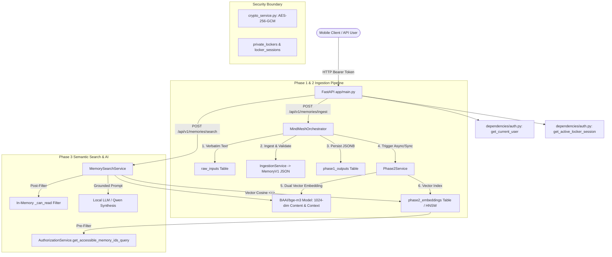
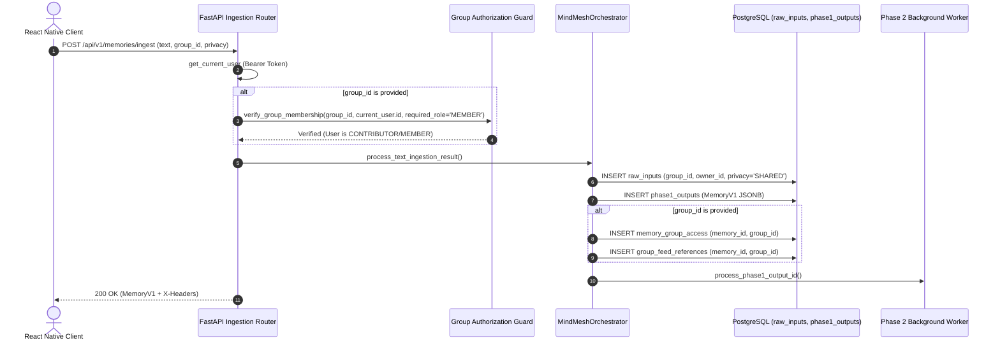
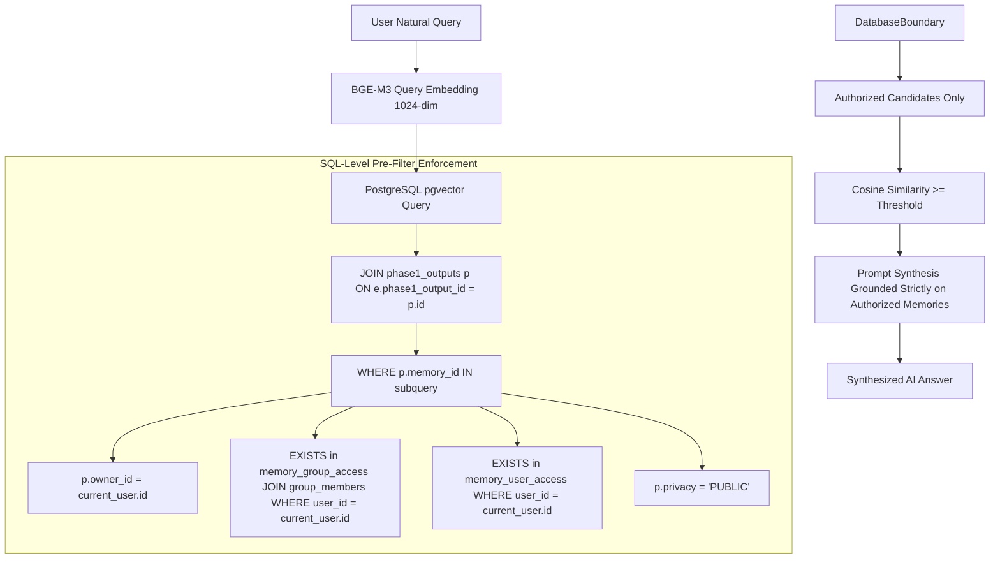
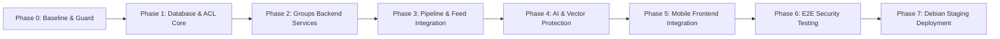

# MINDMESH — COMPLETE GROUPS & ACL IMPLEMENTATION DISCOVERY, ARCHITECTURE AUDIT AND TECHNICAL BLUEPRINT

**Document Status:** Complete Architecture Discovery & Implementation Blueprint  
**Primary Project Target:** `F:\MindMesh-mindmesh-core\MindMesh-mindmesh-core`  
**Reference Prototypes Analyzed:** `D:\final mindmesh work\final mindmesh work\MindMesh_Groups_Canonical_Integration` & `MindMesh_Groups_Implementation_Plan.md`  
**Target Debian Staging Server:** `10.9.11.238` (Path: `/home/coeai/mindmesh_copy/mindmesh` | User: `coeai`)  
**Protected Debian Production:** `/home/coeai/mindmesh` (Strictly untouched)  
**Primary Author:** Principal Software Architect, Senior Application Security Architect & AI Pipeline Engineer  
**Date of Audit:** October 2026  
**Security Classification:** Strict Internal Architectural Specification  

---

## 1. EXECUTIVE SUMMARY

MindMesh is a dual-vector, AI-native memory intelligence system integrating FastAPI, PostgreSQL (pgvector HNSW), BAAI/bge-m3 embeddings (1024-dimensional dual vectors: content and context), local LLM grounded synthesis (Qwen), and an Expo/React Native mobile client. 

Following a deep-dive, read-only architectural inspection of the active Windows development workspace at `F:\MindMesh-mindmesh-core\MindMesh-mindmesh-core`, the platform currently exhibits a **partial, fragmented, and vulnerable foundation** regarding collaborative Groups and Access Control Lists (ACL):

1. **Database Schema State:** The active Windows PostgreSQL migrations (`001_initial_schema.sql`, `002_phase2_schema.sql`, `003_auth_and_locker.sql`) contain NO tables for groups, group memberships, group invitations, or memory sharing. A `group_id` column exists on `raw_inputs` (from migration 001), but `phase1_outputs` and `phase2_embeddings` lack relational group foreign keys or relational sharing tables.
2. **Authorization Layer Disconnect:** An `AuthorizationService` (`backend/app/services/authz_service.py`) contains stubbed logic guarded by `try: from app.database.models.groups import ... except: HAS_GROUPS_TABLES = False`. Because `groups.py` does not exist in the active backend model directory, `HAS_GROUPS_TABLES` evaluates to `False` at runtime, completely disabling relational group checks.
3. **Severe Information Disclosure Vulnerabilities:**
   - In `backend/app/api/routes/memories.py`, `GET /api/v1/memories/feed?group_id={group_id}` executes an unconstrained SQL query against `raw_inputs` filtering only by `group_id` with **zero validation** of whether the requesting user is a member of that group.
   - In `backend/app/services/memory_search_service.py`, the in-memory privacy filter `_can_read()` contains `if privacy in ("GROUP", "PUBLIC"): return True`, allowing any authenticated user to read all group memories across the system during semantic search.
   - Ingestion routes (`/api/v1/memories/ingest`, `/ingest/image`, `/ingest/audio`) accept arbitrary `group_id` parameters without checking group existence or user membership.
4. **Privacy Enum Divergence:** `backend/app/core/enums.py` defines `Privacy(str, Enum)` as `ONLY_ME`, `GROUP`, `SELECTED`, `PRIVATE_LOCKER`. However, `authz_service.py` evaluates strings `"PUBLIC"` and `"SHARED"`, while `Phase1OutputModel.privacy` defaults to `"ONLY_ME"`.
5. **Mobile Frontend State:** The active React Native mobile client (`mindmesh-mobile`) uses state-based screen routing (`ScreenId` in `App.tsx` and `FloatingBottomDock.tsx`) containing Stream, Composer, Vault, and Locker. There is **no Groups screen, group navigation tab, or group API client integration** in the active mobile project. (A 20-line empty UI stub existed only in an external reference folder).
6. **Migration Runner Hazard:** `backend/app/database/migrations/runner.py` executes `sorted(migrations_dir.glob("*.sql"))`. Because `003_rollback_auth_and_locker.sql` resides in the same directory, lexicographical sorting runs the rollback script *after* `003_auth_and_locker.sql`, destroying Private Locker tables if executed on a live PostgreSQL instance.

This blueprint establishes the complete, production-grade specification required to implement Groups and resource-level ACLs across all 7 layers of MindMesh without breaking existing single-user workflows, degrading pgvector retrieval performance, or compromising Private Locker isolation.

---

## 2. AUDIT SCOPE AND EVIDENCE BASE

The architectural discoveries in this report are grounded in direct inspection of source code, schemas, and tests in the primary development repository:

- **Primary Project Root:** `F:\MindMesh-mindmesh-core\MindMesh-mindmesh-core`
  - Backend Entry: `backend/app/main.py`
  - Core Definitions: `backend/app/core/enums.py`, `errors.py`, `logging.py`
  - Database Models: `backend/app/database/models/` (`base.py`, `user.py`, `raw_input.py`, `phase1_output.py`, `phase2_embedding.py`, `locker.py`)
  - Repositories: `backend/app/database/repositories/` (`raw_input_repo.py`, `phase1_output_repo.py`, `phase2_embedding_repo.py`)
  - Migrations: `backend/app/database/migrations/` (`001_initial_schema.sql`, `002_phase2_schema.sql`, `003_auth_and_locker.sql`, `003_rollback_auth_and_locker.sql`, `runner.py`)
  - API Routes: `backend/app/api/routes/` (`auth.py`, `locker.py`, `media.py`, `memories.py`)
  - Dependencies: `backend/app/api/dependencies/auth.py`
  - Services: `backend/app/services/` (`auth_service.py`, `authz_service.py`, `crypto_service.py`, `embedding_service.py`, `ingestion_service.py`, `locker_service.py`, `memory_search_service.py`, `phase2_service.py`)
  - Orchestration: `backend/app/orchestration/orchestrator.py`
  - Frontend: `mindmesh-mobile/App.tsx`, `src/types/index.ts`, `src/services/apiClient.ts`, `src/screens/`
  - Test Suites: `backend/tests/` (71 passed tests, including `test_locker_22_security_audit.py`)
- **Secondary Reference Implementations:**
  - `D:\final mindmesh work\final mindmesh work\MindMesh_Groups_Canonical_Integration` (prototype `groups.py`, `comments.py`, `test_groups_full_e2e.py`)
  - `D:\final mindmesh work\final mindmesh work\MindMesh_Groups_Implementation_Plan.md` (initial conceptual outline)

---

## 3. ACTUAL MINDMESH ARCHITECTURE (AS-IS)



### Architectural Realities:
- **Database Engine:** Async SQLAlchemy with asyncpg on PostgreSQL (SQLite fallback for in-memory unit tests).
- **Dual Vector Architecture:** Each memory produces two 1024-dim vectors:
  - `content_vector`: captures "what happened" (clean_text, raw_text, summary, description).
  - `context_vector`: captures semantic context (entities, topics, sentiment, mood, temporal metadata).
- **Private Locker Boundary:** Strict isolation is maintained via AES-256-GCM column encryption (`enc:v1:...`), requiring `X-Locker-Token` validation and transient in-memory decryption strictly for embedding generation.

---

## 4. RELEVANT PROJECT FILE TREE

```text
F:\MindMesh-mindmesh-core\MindMesh-mindmesh-core├── backend│   ├── app│   │   ├── api│   │   │   ├── dependencies│   │   │   │   └── auth.py                   # get_current_user, get_active_locker_session
│   │   │   └── routes│   │   │       ├── auth.py                   # /api/v1/auth (register, login, logout, me)
│   │   │       ├── locker.py                 # /api/v1/locker (setup, unlock, status, lock)
│   │   │       ├── media.py                  # /api/v1/media/{storage_key}
│   │   │       └── memories.py               # /api/v1/memories (ingest, feed, search)
│   │   ├── core│   │   │   ├── enums.py                      # MediaType, Privacy, Sentiment
│   │   │   ├── errors.py                     # Domain error hierarchy
│   │   │   └── logging.py
│   │   ├── database│   │   │   ├── connection│   │   │   │   └── session.py                # Async engine & sessionmaker
│   │   │   ├── migrations│   │   │   │   ├── 001_initial_schema.sql    # raw_inputs, phase1_outputs
│   │   │   │   ├── 002_phase2_schema.sql     # phase2_embeddings (vector 1024)
│   │   │   │   ├── 003_auth_and_locker.sql   # users, sessions, lockers
│   │   │   │   ├── 003_rollback_auth_and_locker.sql # DANGEROUS ROLLBACK SCRIPT
│   │   │   │   └── runner.py                 # Sequential migration executor
│   │   │   ├── models│   │   │   │   ├── base.py                   # Base, GUID type decorator
│   │   │   │   ├── user.py                   # UserModel, UserSessionModel
│   │   │   │   ├── raw_input.py              # RawInputModel
│   │   │   │   ├── phase1_output.py          # Phase1OutputModel (MemoryV1 JSONB)
│   │   │   │   ├── phase2_embedding.py       # Phase2EmbeddingModel (HNSW pgvector)
│   │   │   │   └── locker.py                 # PrivateLockerModel, LockerSessionModel
│   │   │   └── repositories│   │   │       ├── base.py
│   │   │       ├── raw_input_repo.py
│   │   │       ├── phase1_output_repo.py
│   │   │       └── phase2_embedding_repo.py
│   │   ├── orchestration│   │   │   └── orchestrator.py               # MindMeshOrchestrator pipeline coordinator
│   │   ├── schemas│   │   │   ├── ingestion_request.py          # TextIngestionRequest
│   │   │   ├── memory_output.py              # MemoryV1, ContentFields, SystemFields
│   │   │   ├── phase2_schemas.py
│   │   │   └── search_schemas.py             # MemorySearchRequest, MemorySearchResponse
│   │   ├── services│   │   │   ├── auth_service.py               # Argon2id password hashing, sessions
│   │   │   ├── authz_service.py              # STUBBED AuthorizationService
│   │   │   ├── crypto_service.py             # AES-256-GCM LockerCrypto
│   │   │   ├── embedding_service.py          # BAAI/bge-m3 embedding inference
│   │   │   ├── ingestion_service.py          # Phase 1 extraction parser
│   │   │   ├── locker_service.py             # Locker session management
│   │   │   ├── memory_search_service.py      # Dual-vector retrieval & LLM synthesis
│   │   │   └── phase2_service.py             # In-RAM decryption & embedding indexing
│   │   ├── storage│   │   │   └── file_storage.py               # Local binary media storage
│   │   ├── config.py
│   │   └── main.py                           # FastAPI application root
│   └── tests\                                # 71 automated pytest suites
└── mindmesh-mobile    ├── App.tsx                               # Root navigation & state container
    └── src        ├── auth        │   ├── AuthContext.tsx               # AuthProvider, useAuth
        │   ├── authService.ts                # Token management, login/register API
        │   └── authTypes.ts
        ├── components        │   ├── FloatingBottomDock.tsx        # 4-tab floating navigation dock
        │   └── MindMeshLogo.tsx
        ├── config        │   └── apiConfig.ts                  # Dynamic IP / Base URL resolution
        ├── screens        │   ├── ComposerScreen.tsx            # Memory creation & media capture
        │   ├── HomeScreen.tsx                # Mind Stream feed
        │   ├── LockerScreen.tsx              # Private Locker UI
        │   ├── LoginScreen.tsx
        │   ├── MemoryDetailScreen.tsx        # Single memory view
        │   ├── SignUpScreen.tsx
        │   └── VaultScreen.tsx               # Semantic search & AI Q&A
        ├── services        │   ├── apiClient.ts                  # HTTP client for FastAPI backend
        │   └── memoryAdapter.ts              # MemoryV1 to MemoryItem transformation
        └── types            └── index.ts                      # TypeScript domain interfaces
```

---

## 5. EXISTING GROUPS IMPLEMENTATION AUDIT

| Component / Symbol | File Path | Current Status | Implemented Functionality | Critical Deficiencies |
| :--- | :--- | :--- | :--- | :--- |
| `group_id` column | `backend/app/database/models/raw_input.py:34` | **PARTIAL** | Stores string identifier on `raw_inputs` | Not a foreign key; no relational validation against any groups table. |
| `group_id` field | `backend/app/schemas/ingestion_request.py:17` | **PARTIAL** | Accepted in request payload | Ingestion endpoint accepts arbitrary string without checking user membership. |
| `feed?group_id=` | `backend/app/api/routes/memories.py:195-217` | **VULNERABLE** | Queries `raw_inputs` where `group_id == group_id` | **Zero membership check.** Any authenticated user can read any group's raw feed. |
| `AuthorizationService` | `backend/app/services/authz_service.py:1-73` | **PLACEHOLDER** | Imports `groups.py` in `try/except`; checks `privacy == "PUBLIC"` and `"SHARED"` | `HAS_GROUPS_TABLES` is `False`. `enums.py` lacks `SHARED` and `PUBLIC`. Logic is non-functional. |
| In-memory `_can_read` | `backend/app/services/memory_search_service.py:35-51` | **VULNERABLE** | Evaluates candidate memories | Contains `if privacy in ("GROUP", "PUBLIC"): return True`, exposing all group memories to search. |
| `GroupModel` | *Missing in active backend* | **MISSING** | Prototyped in `D:\...\MindMesh_Groups_Canonical_Integration` | Not migrated or registered in active `backend/app/database/models/`. |
| `GroupMemberModel` | *Missing in active backend* | **MISSING** | Prototyped in `D:\...\MindMesh_Groups_Canonical_Integration` | Membership and role models absent from active database. |
| Group Routes | *Missing in active backend* | **MISSING** | Prototyped in `D:\...\MindMesh_Groups_Canonical_Integration` | No endpoints for `/api/v1/groups` or `/members` registered in `app/main.py`. |
| Mobile Groups Screen | *Missing in active frontend* | **MISSING** | 20-line stub in `D:\...\mindmesh-mobile\src\screens\GroupsScreen.tsx` | Completely missing from active mobile client; not in `FloatingBottomDock.tsx` or `App.tsx`. |

---

## 6. EXISTING AUTHENTICATION ARCHITECTURE

### Current Authentication Flow
1. **User Identity Model:** `UserModel` (`backend/app/database/models/user.py:11-29`) defines:
   - `id`: `VARCHAR(64)` primary key (e.g., `U_<uuid>` or `U_DEVELOPMENT`).
   - `username`: `VARCHAR(128)` unique index.
   - `password_hash`: `VARCHAR(256)` Argon2id hash.
2. **Session Persistence:** `UserSessionModel` (`backend/app/database/models/user.py:32-58`) stores:
   - `token_hash`: `VARCHAR(256)` SHA-256 hash of the 32-byte hexadecimal bearer token.
   - `expires_at`: `TIMESTAMPTZ` (default 30-day lifetime).
   - `revoked`: `BOOLEAN` soft revocation flag.
3. **Dependency Injection:** `get_current_user` (`backend/app/api/dependencies/auth.py:17-49`):
   - Extracts `Authorization: Bearer <token>` from incoming request headers.
   - Hashes token via SHA-256 and retrieves user from `AuthService.get_active_user_from_token()`.
   - **Development Fallback:** In non-production environments (`settings.app_env != "production"`), requests lacking credentials fallback to `UserModel(id="U_DEVELOPMENT", username="development")`.
4. **Frontend Integration:**
   - `mindmesh-mobile/src/auth/AuthContext.tsx` maintains active session state in React Context.
   - Secure token storage backed by `AsyncStorage` via `mindmesh-mobile/src/auth/authStorage.ts`.
   - `apiClient.ts` attaches `Authorization: Bearer <token>` to all backend requests.

### Groups Authentication Strategy:
The Groups subsystem will **strictly reuse** the existing `UserModel` and `get_current_user` dependency. No secondary authentication scheme or shadow tokens will be introduced. All Group API operations will require an authenticated `current_user: UserModel = Depends(get_current_user)`.

---

## 7. ACCESS CONTROL LIST AND ROLE-BASED ACCESS CONTROL (RBAC)

MindMesh requires a hybrid **RBAC + Resource-Level ACL** architecture to manage collaborative spaces and individual memory permissions.

### 7.1 Proposed Role Model
- **OWNER:** The creator of the group or the user to whom ownership was explicitly transferred. Complete administrative control.
- **ADMIN:** Delegated administrative authority. Can manage members, moderate group memories, and invite users.
- **CONTRIBUTOR:** Can upload memories, share memories to the group, comment, and edit/delete their own contributed memories.
- **MEMBER:** Can view group feed, search group memories, view media, comment, and share permitted memories.
- **GUEST:** Read-only access to group feed, search, and media. Cannot upload, share, or comment.

### 7.2 Proposed Role-Permission Matrix

| Permission | OWNER | ADMIN | CONTRIBUTOR | MEMBER | GUEST |
| :--- | :---: | :---: | :---: | :---: | :---: |
| `group:view_details` | Yes | Yes | Yes | Yes | Yes |
| `group:view_members` | Yes | Yes | Yes | Yes | Yes |
| `group:update_details` | Yes | Yes | No | No | No |
| `group:delete` | Yes | No | No | No | No |
| `group:transfer_ownership` | Yes | No | No | No | No |
| `member:invite` | Yes | Yes | No | No | No |
| `member:remove` | Yes | Yes* | No | No | No |
| `member:change_role` | Yes | Yes* | No | No | No |
| `memory:upload_to_group` | Yes | Yes | Yes | Yes | No |
| `memory:share_existing` | Yes | Yes | Yes | Yes | No |
| `memory:view_feed` | Yes | Yes | Yes | Yes | Yes |
| `memory:search_semantic` | Yes | Yes | Yes | Yes | Yes |
| `memory:view_media` | Yes | Yes | Yes | Yes | Yes |
| `memory:edit_own` | Yes | Yes | Yes | Yes | No |
| `memory:edit_others` | Yes | Yes | No | No | No |
| `memory:delete_own` | Yes | Yes | Yes | Yes | No |
| `memory:delete_others` | Yes | Yes | No | No | No |
| `memory:revoke_sharing` | Yes | Yes | Yes (own) | Yes (own) | No |
| `comment:create` | Yes | Yes | Yes | Yes | No |
| `comment:delete_own` | Yes | Yes | Yes | Yes | No |
| `comment:delete_others` | Yes | Yes | No | No | No |

*\*Note: Admins cannot remove, demote, or modify the OWNER or fellow ADMINs.*

### 7.3 Authorization Resolution Algorithm
When a user requests access to a memory M (via feed, detail, search, media, or comments):
1. **Private Locker Isolation Gate:** If M.privacy == "PRIVATE_LOCKER", access is granted **IF AND ONLY IF** M.owner_id == current_user.id AND locker_session_valid == True. Otherwise, **IMMEDIATE HARD DENY (403/404)**. Group sharing of private locker content is strictly prohibited.
2. **Personal Ownership Gate:** If M.owner_id == current_user.id, grant access.
3. **Public Memory Gate:** If M.privacy == "PUBLIC", grant access.
4. **Direct User ACL Gate:** If an active record exists in `memory_user_access` where memory_id == M.id and user_id == current_user.id, grant access.
5. **Group ACL Gate:** If an active record exists in `memory_group_access` where memory_id == M.id, check if current_user.id is an active member of that group in `group_members`. If yes, evaluate group role permissions.
6. **Default Deny:** In all other cases, return **DENY (HTTP 403 Forbidden / 404 Not Found)**.

---

## 8. POSTGRESQL & PGVECTOR SCHEMA INVENTORY (CURRENT STATE)

### Currently Deployed Database Tables:
1. `raw_inputs` (`001_initial_schema.sql` + `003_auth_and_locker.sql`):
   - `id`: `UUID PRIMARY KEY`
   - `media_type`: `VARCHAR(32)` (`text`, `image`, `audio`)
   - `raw_payload`: `TEXT` (ciphertext if private locker)
   - `structured_payload`: `JSONB`
   - `client_id`: `VARCHAR(64)`
   - `owner_id`: `VARCHAR(64) REFERENCES users(id)`
   - `group_id`: `VARCHAR(64)` (unindexed string)
   - `privacy`: `VARCHAR(32)` (default `'ONLY_ME'`)
   - `status`: `VARCHAR(32)` (`received`, `processing`, `completed`, `failed`)
   - `received_at`: `TIMESTAMPTZ`
2. `phase1_outputs` (`001_initial_schema.sql` + `003_auth_and_locker.sql`):
   - `id`: `UUID PRIMARY KEY`
   - `raw_input_id`: `UUID REFERENCES raw_inputs(id) ON DELETE CASCADE`
   - `memory_id`: `VARCHAR(64) UNIQUE` (e.g. `M_<uuid>`)
   - `schema_version`: `VARCHAR(16)`
   - `owner_id`: `VARCHAR(64) REFERENCES users(id)`
   - `privacy`: `VARCHAR(32)` (default `'ONLY_ME'`)
   - `payload`: `JSONB` (Complete canonical MemoryV1)
   - `processing_status`: `VARCHAR(32)`
   - `extractor_model`: `VARCHAR(128)`
   - `created_at`: `TIMESTAMPTZ`
3. `phase2_embeddings` (`002_phase2_schema.sql`):
   - `id`: `UUID PRIMARY KEY`
   - `phase1_output_id`: `UUID UNIQUE REFERENCES phase1_outputs(id)`
   - `memory_id`: `VARCHAR(64) UNIQUE REFERENCES phase1_outputs(memory_id)`
   - `content_vector`: `vector(1024)` (HNSW cosine index `idx_phase2_embeddings_content_hnsw`)
   - `context_vector`: `vector(1024)` (HNSW cosine index `idx_phase2_embeddings_context_hnsw`)
   - `embedding_model`: `VARCHAR(128)` (`BAAI/bge-m3`)
   - `created_at`: `TIMESTAMPTZ`
4. `users` & `user_sessions` (`003_auth_and_locker.sql`)
5. `private_lockers` & `locker_sessions` (`003_auth_and_locker.sql`)

---

## 9. PROPOSED GROUPS AND ACL DATABASE SCHEMA (TARGET STATE)

To establish complete group collaboration without compromising single-user workflows, Migration `004_groups_and_acl.sql` must be introduced:

```sql
-- ==============================================================================
-- MindMesh Platform Schema Migration: 004_groups_and_acl.sql
-- Production Groups, Memberships, Invitations, ACLs & Collaborative Comments
-- ==============================================================================

-- 1. Table: groups
CREATE TABLE IF NOT EXISTS groups (
    id UUID PRIMARY KEY DEFAULT gen_random_uuid(),
    name VARCHAR(128) NOT NULL,
    description TEXT,
    avatar_url VARCHAR(512),
    created_by VARCHAR(64) REFERENCES users(id) ON DELETE SET NULL,
    is_archived BOOLEAN DEFAULT FALSE NOT NULL,
    created_at TIMESTAMPTZ DEFAULT CURRENT_TIMESTAMP NOT NULL,
    updated_at TIMESTAMPTZ DEFAULT CURRENT_TIMESTAMP NOT NULL
);
CREATE INDEX IF NOT EXISTS idx_groups_created_by ON groups(created_by);
CREATE INDEX IF NOT EXISTS idx_groups_created_at ON groups(created_at);

-- 2. Table: group_members
CREATE TABLE IF NOT EXISTS group_members (
    group_id UUID NOT NULL REFERENCES groups(id) ON DELETE CASCADE,
    user_id VARCHAR(64) NOT NULL REFERENCES users(id) ON DELETE CASCADE,
    role VARCHAR(32) DEFAULT 'MEMBER' NOT NULL, -- OWNER, ADMIN, CONTRIBUTOR, MEMBER, GUEST
    joined_at TIMESTAMPTZ DEFAULT CURRENT_TIMESTAMP NOT NULL,
    PRIMARY KEY (group_id, user_id)
);
CREATE INDEX IF NOT EXISTS idx_group_members_user_id ON group_members(user_id);
CREATE INDEX IF NOT EXISTS idx_group_members_role ON group_members(role);

-- 3. Table: group_invitations
CREATE TABLE IF NOT EXISTS group_invitations (
    id UUID PRIMARY KEY DEFAULT gen_random_uuid(),
    group_id UUID NOT NULL REFERENCES groups(id) ON DELETE CASCADE,
    inviter_id VARCHAR(64) NOT NULL REFERENCES users(id) ON DELETE CASCADE,
    invitee_email VARCHAR(256) NOT NULL,
    token_hash VARCHAR(256) UNIQUE NOT NULL,
    role VARCHAR(32) DEFAULT 'MEMBER' NOT NULL,
    status VARCHAR(32) DEFAULT 'PENDING' NOT NULL, -- PENDING, ACCEPTED, REJECTED, EXPIRED
    expires_at TIMESTAMPTZ NOT NULL,
    created_at TIMESTAMPTZ DEFAULT CURRENT_TIMESTAMP NOT NULL
);
CREATE INDEX IF NOT EXISTS idx_group_invitations_group_id ON group_invitations(group_id);
CREATE INDEX IF NOT EXISTS idx_group_invitations_email ON group_invitations(invitee_email);

-- 4. Table: memory_group_access (Resource-Level Group Sharing ACL)
CREATE TABLE IF NOT EXISTS memory_group_access (
    memory_id VARCHAR(64) NOT NULL REFERENCES phase1_outputs(memory_id) ON DELETE CASCADE,
    group_id UUID NOT NULL REFERENCES groups(id) ON DELETE CASCADE,
    granted_by VARCHAR(64) REFERENCES users(id) ON DELETE SET NULL,
    can_edit BOOLEAN DEFAULT FALSE NOT NULL,
    can_reshare BOOLEAN DEFAULT FALSE NOT NULL,
    created_at TIMESTAMPTZ DEFAULT CURRENT_TIMESTAMP NOT NULL,
    PRIMARY KEY (memory_id, group_id)
);
CREATE INDEX IF NOT EXISTS idx_mga_group_id ON memory_group_access(group_id);
CREATE INDEX IF NOT EXISTS idx_mga_memory_id ON memory_group_access(memory_id);

-- 5. Table: memory_user_access (Resource-Level Individual Sharing ACL)
CREATE TABLE IF NOT EXISTS memory_user_access (
    memory_id VARCHAR(64) NOT NULL REFERENCES phase1_outputs(memory_id) ON DELETE CASCADE,
    user_id VARCHAR(64) NOT NULL REFERENCES users(id) ON DELETE CASCADE,
    granted_by VARCHAR(64) REFERENCES users(id) ON DELETE SET NULL,
    can_edit BOOLEAN DEFAULT FALSE NOT NULL,
    created_at TIMESTAMPTZ DEFAULT CURRENT_TIMESTAMP NOT NULL,
    PRIMARY KEY (memory_id, user_id)
);
CREATE INDEX IF NOT EXISTS idx_mua_user_id ON memory_user_access(user_id);
CREATE INDEX IF NOT EXISTS idx_mua_memory_id ON memory_user_access(memory_id);

-- 6. Table: group_feed_references (Explicit Memory Feed Associations)
CREATE TABLE IF NOT EXISTS group_feed_references (
    id UUID PRIMARY KEY DEFAULT gen_random_uuid(),
    memory_id VARCHAR(64) NOT NULL REFERENCES phase1_outputs(memory_id) ON DELETE CASCADE,
    group_id UUID NOT NULL REFERENCES groups(id) ON DELETE CASCADE,
    shared_by VARCHAR(64) REFERENCES users(id) ON DELETE SET NULL,
    created_at TIMESTAMPTZ DEFAULT CURRENT_TIMESTAMP NOT NULL,
    CONSTRAINT uq_group_feed_ref UNIQUE (group_id, memory_id)
);
CREATE INDEX IF NOT EXISTS idx_gfr_group_id ON group_feed_references(group_id);
CREATE INDEX IF NOT EXISTS idx_gfr_memory_id ON group_feed_references(memory_id);

-- 7. Table: comments (Collaborative Memory Discussions & Knowledge Capture)
CREATE TABLE IF NOT EXISTS comments (
    id UUID PRIMARY KEY DEFAULT gen_random_uuid(),
    memory_id VARCHAR(64) NOT NULL REFERENCES phase1_outputs(memory_id) ON DELETE CASCADE,
    author_id VARCHAR(64) NOT NULL REFERENCES users(id) ON DELETE CASCADE,
    content TEXT NOT NULL,
    is_knowledge_eligible BOOLEAN DEFAULT FALSE NOT NULL,
    derived_memory_id VARCHAR(64) REFERENCES phase1_outputs(memory_id) ON DELETE SET NULL,
    created_at TIMESTAMPTZ DEFAULT CURRENT_TIMESTAMP NOT NULL,
    updated_at TIMESTAMPTZ DEFAULT CURRENT_TIMESTAMP NOT NULL
);
CREATE INDEX IF NOT EXISTS idx_comments_memory_id ON comments(memory_id);
CREATE INDEX IF NOT EXISTS idx_comments_author_id ON comments(author_id);
CREATE INDEX IF NOT EXISTS idx_comments_created_at ON comments(created_at);
```

---

## 10. MEMORY PRIVACY, LIFECYCLE & SHARING RULES

### 10.1 Harmonized Privacy Classifications
The enum divergence between `enums.py` and `authz_service.py` must be unified across the entire stack:

```python
class Privacy(str, Enum):
    ONLY_ME = "ONLY_ME"             # Sovereign personal memory; readable only by owner
    SHARED = "SHARED"               # Shared via memory_group_access or memory_user_access
    PUBLIC = "PUBLIC"               # Globally accessible across the tenant/system
    PRIVATE_LOCKER = "PRIVATE_LOCKER" # Hardware/PIN isolated sovereign vault (strictly isolated)
```
*(Deprecate legacy `"GROUP"` and `"SELECTED"` string variants into `"SHARED"` with relational rows).*

### 10.2 Sharing Models & Immutability of Ownership
1. **User-Owned Architecture (Recommended & Required):**
   - Memories created within a group or shared to a group retain their original creator as `owner_id`.
   - MindMesh will **never transfer memory ownership to the group entity**. If a user leaves a group, their personal memories remain theirs, but the corresponding `memory_group_access` records are cleanly detached upon request.
2. **Multi-Group Sharing:**
   - A single memory can be shared with Group A, Group B, and User C simultaneously by inserting rows into `memory_group_access` and `memory_user_access`.
   - **Zero Vector Duplication:** Only one `phase1_outputs` and one `phase2_embeddings` record exists. Retrieval evaluates relational joins to determine authorization.
3. **Private Locker Firewall:**
   - Any attempt to share a memory whose `privacy == "PRIVATE_LOCKER"` throws HTTP 400 Bad Request ("Private locker memories cannot be shared with groups or other users").
   - A Private Locker memory cannot be targeted by `memory_group_access` or `group_feed_references`.

---

## 11. PHASE 1 PIPELINE INTEGRATION — GROUP INGESTION

### Current Ingestion Vulnerability
In `backend/app/api/routes/memories.py`:
```python
@router.post("/ingest", response_model=MemoryV1)
async def ingest_memory(request: TextIngestionRequest, ...):
    # Missing: validate whether request.group_id is valid and user is a member!
```
Any caller can pass `"group_id": "G_ARBITRARY"` and inject memories into another team's stream.

### Hardened Phase 1 Ingestion Workflow


---

## 12. PHASE 2 PIPELINE INTEGRATION — GROUP EMBEDDINGS & STORAGE

### Key Architectural Discovery:
In `backend/app/database/models/phase2_embedding.py` and `Phase2EmbeddingRepository`:
- The `phase2_embeddings` table does **not** store metadata columns such as `privacy`, `owner_id`, or `group_id`.
- Dual vectors (`content_vector` and `context_vector`) represent pure semantic geometry.
- Vector records link exclusively via foreign keys:
  `phase1_output_id -> phase1_outputs.id` and `memory_id -> phase1_outputs.memory_id`.

### Storage & Privacy Invariant:
1. **Zero Ciphertext Embeddings:** Group memories are stored in plaintext in `phase1_outputs.payload` (unlike Private Locker which uses `enc:v1:`). BGE-M3 encodes clean semantic vectors directly.
2. **No Secondary Vector Index Required:** Group memories live in the same HNSW index as personal memories. Privacy and group isolation are enforced during the **Candidate Retrieval Boundary** via relational SQL joins, avoiding index fragmentation.

---

## 13. PHASE 3 PIPELINE INTEGRATION — ACL-AWARE SEMANTIC RETRIEVAL & AI ANSWERING

### 13.1 The Vector Leakage Threat
If pgvector retrieval runs a pure ANN search and performs authorization filtering in application memory *after* Top-K selection:
- A user querying sensitive keywords could match another group's memories in the Top-K.
- After discarding unauthorized matches, 0 or fewer than Top-K results remain, and vector distance metadata leaks existence.
- **Worse:** In the current codebase (`memory_search_service.py:46`), `if privacy in ("GROUP", "PUBLIC"): return True` directly passes foreign group memories into the Qwen prompt context!

### 13.2 Hardened Dual-Layer Retrieval Architecture



### 13.3 Optimized PostgreSQL Retrieval SQL:
```sql
SELECT 
    e.id AS embedding_id,
    e.phase1_output_id,
    e.memory_id,
    p.payload AS memory_payload,
    (1 - (e.content_vector <=> CAST(:qvec AS vector))) AS content_similarity,
    (1 - (e.context_vector <=> CAST(:qvec AS vector))) AS context_similarity,
    ((:c_w * (1 - (e.content_vector <=> CAST(:qvec AS vector)))) +
     (:ctx_w * (1 - (e.context_vector <=> CAST(:qvec AS vector))))) AS combined_similarity
FROM phase2_embeddings e
JOIN phase1_outputs p ON e.phase1_output_id = p.id
WHERE p.memory_id IN (
    -- 1. Own non-private memories (or private if locker valid)
    SELECT memory_id FROM phase1_outputs 
    WHERE owner_id = :user_id 
      AND (privacy != 'PRIVATE_LOCKER' OR :locker_valid = true)
    
    UNION
    
    -- 2. Public memories
    SELECT memory_id FROM phase1_outputs WHERE privacy = 'PUBLIC'
    
    UNION
    
    -- 3. Memories shared directly to user
    SELECT memory_id FROM memory_user_access WHERE user_id = :user_id
    
    UNION
    
    -- 4. Memories shared to groups where user is an active member
    SELECT mga.memory_id 
    FROM memory_group_access mga
    JOIN group_members gm ON mga.group_id = gm.group_id
    WHERE gm.user_id = :user_id
      AND (:filter_group_id IS NULL OR mga.group_id = :filter_group_id)
)
ORDER BY combined_similarity DESC
LIMIT :top_k;
```

---

## 14. FRONTEND GROUPS ARCHITECTURE & MOBILE AUDIT

### Current Mobile Implementation State (`mindmesh-mobile`):
- **UI Architecture:** State-based routing managed by `ScreenId` (`'welcome' | 'login' | 'signup' | 'forgot_password' | 'home' | 'composer' | 'memory_detail' | 'vault' | 'locker'`).
- **Navigation Dock:** `FloatingBottomDock.tsx` renders 4 tabs:
  1. `Stream` (`HomeScreen.tsx`)
  2. Center `+` (`ComposerScreen.tsx`)
  3. `Vault` (`VaultScreen.tsx`)
  4. `Locker` (`LockerScreen.tsx`)
- **Missing Group Screens:** No group listing screen, no group details, no member management modal, and no group sharing dialog.

### Proposed UI/UX Integration (Preserving Visual Aesthetics):
1. **Floating Bottom Dock Extension:**
   - Expand `FloatingBottomDock.tsx` to include a **Groups** tab with icon `people-outline` / `people`.
   - Update `ScreenId` in `src/types/index.ts` to include `'groups'` and `'group_detail'`.
2. **New Screens to Create:**
   - `src/screens/GroupsScreen.tsx`: List user's groups, group creation modal, pending invitations list.
   - `src/screens/GroupDetailScreen.tsx`: Group feed, collaborative knowledge tabs, member management, invite modal.
3. **Screen Enhancements:**
   - `ComposerScreen.tsx`: When `selectedDestination === 'group'`, render a group selector dropdown displaying the user's active groups.
   - `MemoryDetailScreen.tsx`: Add a **"Share to Group"** action button launching an ACL permission sheet.

---

## 15. FRONTEND-BACKEND API CONTRACT MATRIX

| Method | Endpoint | Auth | Role/ACL | Request Schema | Response Schema | Status Codes |
| :--- | :--- | :---: | :---: | :--- | :--- | :---: |
| `POST` | `/api/v1/groups` | Bearer | Authenticated | `{ name: str, description?: str }` | `GroupResponse` | 201, 400, 401 |
| `GET` | `/api/v1/groups` | Bearer | Member of group | None | `List[GroupResponse]` | 200, 401 |
| `GET` | `/api/v1/groups/{group_id}` | Bearer | `group:view_details` | None | `GroupDetailResponse` | 200, 401, 403, 404 |
| `PATCH` | `/api/v1/groups/{group_id}` | Bearer | `group:update_details` | `{ name?: str, description?: str }` | `GroupResponse` | 200, 400, 401, 403 |
| `DELETE` | `/api/v1/groups/{group_id}` | Bearer | `group:delete` (OWNER) | None | `{ message: str }` | 200, 401, 403, 404 |
| `GET` | `/api/v1/groups/{group_id}/members` | Bearer | `group:view_members` | None | `List[GroupMemberResponse]` | 200, 401, 403 |
| `POST` | `/api/v1/groups/{group_id}/members` | Bearer | `member:invite` (ADMIN+) | `{ user_id: str, role?: str }` | `GroupMemberResponse` | 201, 400, 401, 403 |
| `PATCH` | `/api/v1/groups/{group_id}/members/{user_id}` | Bearer | `member:change_role` | `{ role: str }` | `GroupMemberResponse` | 200, 400, 401, 403 |
| `DELETE` | `/api/v1/groups/{group_id}/members/{user_id}` | Bearer | `member:remove` or Self | None | `{ message: str }` | 200, 401, 403 |
| `POST` | `/api/v1/memories/{memory_id}/share` | Bearer | Memory Owner | `{ group_ids: List[UUID], user_ids: List[str] }` | `{ message: str, shared_count: int }` | 200, 400, 401, 404 |
| `POST` | `/api/v1/memories/{memory_id}/revoke` | Bearer | Memory Owner | `{ group_ids: List[UUID], user_ids: List[str] }` | `{ message: str }` | 200, 400, 401, 404 |
| `GET` | `/api/v1/memories/feed?group_id={group_id}` | Bearer | Group Member | Query: `limit`, `offset`, `group_id` | `FeedResponse` | 200, 401, 403 |
| `POST` | `/api/v1/memories/{memory_id}/comments` | Bearer | `comment:create` | `{ content: str }` | `CommentResponse` | 201, 400, 401, 403 |
| `GET` | `/api/v1/memories/{memory_id}/comments` | Bearer | Can Read Memory | Query: `limit`, `offset` | `List[CommentResponse]` | 200, 401, 403 |

---

## 16. COMPLETE GROUPS FEATURE MATRIX (28 CAPABILITIES)

| # | Feature Capability | Current Status | Impacted Files | Backend Requirement | Frontend Requirement |
| :-: | :--- | :---: | :--- | :--- | :--- |
| 1 | Create Group | **MISSING** | `routes/groups.py`, `models/groups.py` | Create group & assign creator as OWNER | Modal in `GroupsScreen.tsx` |
| 2 | List My Groups | **MISSING** | `routes/groups.py`, `group_service.py` | Query `group_members WHERE user_id = current` | FlatList in `GroupsScreen.tsx` |
| 3 | View Group Details | **MISSING** | `routes/groups.py` | Fetch group metadata + member counts | Header in `GroupDetailScreen.tsx` |
| 4 | Update Group Details | **MISSING** | `routes/groups.py` | Admin/Owner metadata patch | Settings modal |
| 5 | Delete Group | **MISSING** | `routes/groups.py` | Owner cascade deletion / soft delete | Danger zone confirm dialog |
| 6 | Invite Member | **MISSING** | `routes/groups.py`, `group_invitations` | Generate invitation token / direct add | Invite sheet / email input |
| 7 | Accept Invitation | **MISSING** | `routes/groups.py` | Verify token & create `group_members` | Invite link handling screen |
| 8 | Reject Invitation | **MISSING** | `routes/groups.py` | Update invitation status to REJECTED | Decline button |
| 9 | Remove Member | **MISSING** | `routes/groups.py`, `authz_service.py` | Delete `group_members` row | Member list swipe-to-delete |
| 10 | Change Member Role | **MISSING** | `routes/groups.py` | Owner/Admin update role column | Role picker modal |
| 11 | Leave Group | **MISSING** | `routes/groups.py` | Self-deletion from `group_members` | "Leave Group" button |
| 12 | Transfer Ownership | **MISSING** | `routes/groups.py` | Atomic role swap (OWNER <-> ADMIN) | Owner transfer confirmation |
| 13 | View Member List | **MISSING** | `routes/groups.py` | Query members joined with `users` | Members tab in `GroupDetailScreen` |
| 14 | Upload Group Memory | **PARTIAL** | `routes/memories.py`, `orchestrator.py` | Ingest with membership validation | Group selector in `ComposerScreen` |
| 15 | View Group Feed | **VULNERABLE** | `routes/memories.py` | Fix feed query with membership check | Feed tab in `GroupDetailScreen` |
| 16 | Share Memory to Group | **MISSING** | `routes/memories.py`, `share_service.py` | Insert into `memory_group_access` | "Share" action on `MemoryDetailScreen` |
| 17 | Revoke Shared Memory | **MISSING** | `routes/memories.py`, `share_service.py` | Delete from `memory_group_access` | "Revoke" button in share sheet |
| 18 | Edit Authorized Memory | **MISSING** | `routes/memories.py` | Verify ownership or Admin role | Edit memory modal |
| 19 | Delete Authorized Memory | **MISSING** | `routes/memories.py` | Delete or detach from group feed | Delete confirmation |
| 20 | Add Memory Comments | **MISSING** | `routes/comments.py`, `comment_service.py` | Insert into `comments` table | Comment bar on `MemoryDetailScreen` |
| 21 | View Group Media | **PARTIAL** | `routes/media.py` | Verify media memory group ACL | Media grid view |
| 22 | Download Media | **PARTIAL** | `routes/media.py` | Stream binary file via ACL check | Download icon |
| 23 | Group Semantic Search | **VULNERABLE** | `memory_search_service.py` | Subquery filter by `group_id` | Search filter pill in `VaultScreen` |
| 24 | Group AI Q&A | **VULNERABLE** | `memory_search_service.py` | LLM context grounded only on group | Group toggle in `VaultScreen` |
| 25 | ACL Permission Mgmt | **MISSING** | `services/authz_service.py` | Granular resource ACL verification | Permission manager modal |
| 26 | Instant Revocation | **MISSING** | `authz_service.py` | Real-time SQL join (no stale caches) | Immediate access cut-off |
| 27 | Group Activity History | **MISSING** | `models/groups.py` | Audit log of shares and joins | Activity timeline feed |
| 28 | Group Notifications | **MISSING** | Notifications engine | Trigger alerts on comments/invites | Push / in-app notification badge |

---

## 17. SECURITY THREAT MODEL & DEFENSE-IN-DEPTH

| Threat / Attack Scenario | Severity | Existing Defense | Missing Defense | Recommended Mitigation |
| :--- | :---: | :--- | :--- | :--- |
| **IDOR via Feed Group ID**<br>Attacker queries `/feed?group_id={victim_group_id}` | **CRITICAL** | None. RawInput filtered only by `group_id`. | Verification of caller's membership in group. | Inject `verify_group_member` dependency into `/feed`. |
| **Cross-Group Vector Search Leak**<br>Attacker queries sensitive keywords belonging to foreign group. | **CRITICAL** | Insecure filter: `if privacy == "GROUP": return True`. | SQL pre-filtering and exact membership check. | Replace in-memory check with SQL `IN (SELECT memory_id FROM memory_group_access ...)`. |
| **Private Locker Contamination**<br>User attempts to share Private Locker memory to group. | **HIGH** | Ingestion rejects `PRIVATE_LOCKER + group_id`. | Share endpoint validation. | Enforce strict check in `share_service`: reject if `memory.privacy == "PRIVATE_LOCKER"`. |
| **Unauthorized Media Access**<br>Attacker accesses `/api/v1/media/{key}` belonging to foreign group. | **HIGH** | Checks `can_read_memory`, but `authz_service` is stubbed. | Fully active relational group check in `can_read_memory`. | Complete `authz_service.py` using live `memory_group_access` tables. |
| **Stale Permission Window**<br>Removed member continues accessing group via cached token. | **MEDIUM** | JWT/Hashed session token valid for 30 days. | Real-time database membership join on every request. | ACL checks evaluate live PostgreSQL state on each request without caching. |
| **Privilege Escalation**<br>Member sends `PATCH /members/{id}` with `role="ADMIN"`. | **HIGH** | None. Route missing. | Server-side role check (`adder.role == 'OWNER'`). | Enforce RBAC guard: only OWNER or ADMIN can change roles; only OWNER can create ADMIN. |

---

## 18. EXISTING TEST SUITE COVERAGE & GAPS

### Current Test Execution Status
- The active backend suite (`backend/tests/`) contains **71 automated tests**, all executing successfully on Windows with 0 failures:
  - `test_locker_22_security_audit.py` (22 security assertions for Private Locker)
  - `test_phase2_embeddings.py` (pgvector dual vector storage & cosine retrieval)
  - `test_orchestration_flow.py` (Phase 1 -> Phase 2 pipeline)
  - `test_text_ingestion.py`, `test_audio_ingestion.py`, `test_media_api.py`
- **Zero Test Coverage for Groups:**
  - In `backend/tests/`, there are **0 unit tests, 0 integration tests, and 0 security tests** validating Groups or ACLs.
  - References to `group_id` in existing tests are merely static dummy values (`"G04"`, `"G_TEAM_1"`) used to verify string persistence.

### Missing Test Matrix:
1. `test_group_lifecycle.py`: Creation, retrieval, update, soft deletion, and ownership transfer.
2. `test_group_membership_rbac.py`: Role assignment, member removal, permission escalation rejection.
3. `test_memory_sharing_acl.py`: Sharing to single group, multiple groups, direct users, and revocation.
4. `test_group_feed_isolation.py`: Feed isolation verifying non-members receive HTTP 403.
5. `test_group_semantic_search_security.py`: pgvector retrieval ensuring non-members never match foreign group vectors.
6. `test_private_locker_groups_firewall.py`: Asserting Private Locker memories can never be shared with groups.
7. `test_group_comments_lifecycle.py`: Comment authorization and knowledge-eligibility processing.

---

## 19. REQUIRED END-TO-END TEST SCENARIOS

### Scenario A — Group Lifecycle & Membership Flow
1. User A (Owner) registers, logs in, and creates group `"Alpha"`.
2. User A invites User B as `"ADMIN"` and User C as `"MEMBER"`.
3. User B invites User D as `"CONTRIBUTOR"`.
4. User C attempts to invite User E -> **Fails with 403 Forbidden**.
5. User A transfers ownership to User B -> User B becomes `"OWNER"`, User A becomes `"ADMIN"`.

### Scenario B — Unauthorized Data Access (Negative Testing)
1. User A creates group `"Secret Team"` and uploads Memory M1.
2. User X (authenticated, non-member) attempts:
   - `GET /api/v1/memories/feed?group_id={Secret_Team_ID}` -> **Fails with 403 Forbidden**.
   - `GET /api/v1/media/{M1_storage_key}` -> **Fails with 403 Forbidden**.
   - `POST /api/v1/memories/{M1_ID}/comments` -> **Fails with 403 Forbidden**.
   - `POST /api/v1/memories/search` querying M1 content -> **Zero results returned**.

### Scenario C — Role-Based Permission Boundaries
1. User (GUEST) attempts to upload memory to group -> **403 Forbidden**.
2. User (MEMBER) attempts to delete User D's memory -> **403 Forbidden**.
3. User (ADMIN) deletes User D's memory -> **200 OK**.
4. User (ADMIN) attempts to remove group OWNER -> **403 Forbidden**.

### Scenario D — Instant Revocation Propagation
1. Member C is viewing group feed and accessing media.
2. Admin B removes Member C via `DELETE /api/v1/groups/{id}/members/{user_c_id}`.
3. Member C immediately attempts to fetch feed, search, and download media.
4. **All operations immediately fail with 403 Forbidden** (proving zero latency in revocation).

### Scenario E — Private Locker Privacy Firewall
1. User A unlocks Private Locker with PIN (`X-Locker-Token`).
2. User A creates memory M_vault (`privacy="PRIVATE_LOCKER"`).
3. User A attempts `POST /api/v1/memories/{M_vault_ID}/share` targeting Group Alpha.
4. **Endpoint immediately rejects with 400 Bad Request**.
5. Vector search executed within Group Alpha strictly excludes M_vault even when User A is searching.

---

## 20. FILE-BY-FILE IMPLEMENTATION MANIFEST

### 20.1 Files to CREATE (New Components)

| Path (Project-Relative) | Layer | Purpose & Responsibility |
| :--- | :---: | :--- |
| `backend/app/database/models/groups.py` | Models | SQLAlchemy ORM models: `GroupModel`, `GroupMemberModel`, `GroupInvitationModel`, `MemoryGroupAccessModel`, `MemoryUserAccessModel`, `GroupFeedReferenceModel`. |
| `backend/app/database/models/comments.py` | Models | SQLAlchemy ORM model: `CommentModel`. |
| `backend/app/database/migrations/004_groups_and_acl.sql` | DB | Idempotent PostgreSQL schema migration for groups, memberships, ACLs, and comments. |
| `backend/app/schemas/group.py` | Schemas | Pydantic v2 schemas: `GroupCreateRequest`, `GroupResponse`, `GroupMemberResponse`, `AddMemberRequest`, `ShareMemoryRequest`. |
| `backend/app/schemas/comment.py` | Schemas | Pydantic v2 schemas: `CommentCreateRequest`, `CommentResponse`. |
| `backend/app/services/group_service.py` | Services | Business logic for group CRUD, membership validation, role assignment, and ownership transfer. |
| `backend/app/services/share_service.py` | Services | Business logic for resource-level sharing, multi-group access, and revocation. |
| `backend/app/services/comment_service.py` | Services | Collaborative commenting and knowledge-eligibility evaluation. |
| `backend/app/api/routes/groups.py` | Routes | FastAPI router for `/api/v1/groups` and member management. |
| `backend/app/api/routes/comments.py` | Routes | FastAPI router for `/api/v1/memories/{id}/comments`. |
| `backend/tests/test_groups_lifecycle_e2e.py` | Tests | Comprehensive test suite validating scenarios A through G. |
| `mindmesh-mobile/src/screens/GroupsScreen.tsx` | UI | Groups listing, creation modal, and invitations screen. |
| `mindmesh-mobile/src/screens/GroupDetailScreen.tsx` | UI | Group feed, member management, and collaborative search screen. |

### 20.2 Files to MODIFY (Existing Components)

| Path (Project-Relative) | Layer | Modifications Required | Reason & Risk Mitigation |
| :--- | :---: | :--- | :--- |
| `backend/app/core/enums.py` | Core | Add `SHARED = "SHARED"` and `PUBLIC = "PUBLIC"` to `Privacy`. | Eliminates enum mismatch between schema and authorization logic. |
| `backend/app/database/models/__init__.py` | Models | Export `GroupModel`, `GroupMemberModel`, `CommentModel`, etc. | Ensures Base metadata registers all models for migrations and tests. |
| `backend/app/database/migrations/runner.py` | DB | Filter out `*rollback*.sql` files in migration runner. | **Fixes critical bug** where rollback script was executed during normal migration. |
| `backend/app/services/authz_service.py` | Services | Implement active SQL joins on `memory_group_access` and `group_members`. | Replaces placeholder logic with production ACL enforcement. |
| `backend/app/services/memory_search_service.py` | Services | Remove insecure `privacy == "GROUP"` rule; inject SQL subquery filter. | Prevents unauthorized vector matches from entering LLM context. |
| `backend/app/api/routes/memories.py` | Routes | Inject group membership validation on ingestion and feed routes. | Eliminates IDOR vulnerability on group feeds and memory uploads. |
| `backend/app/api/routes/media.py` | Routes | Ensure media retrieval checks active group membership via Phase 1 memory ID. | Prevents unauthorized binary media downloads. |
| `backend/app/main.py` | App | Register `groups_router` and `comments_router`. | Exposes groups API endpoints on the FastAPI server. |
| `mindmesh-mobile/src/types/index.ts` | Frontend | Add `'groups'` and `'group_detail'` to `ScreenId`; add Group interfaces. | Supports TypeScript typechecking for group UI state. |
| `mindmesh-mobile/src/components/FloatingBottomDock.tsx` | Frontend | Add Groups navigation tab. | Provides intuitive mobile access to groups stream. |
| `mindmesh-mobile/App.tsx` | Frontend | Mount `GroupsScreen` and `GroupDetailScreen` inside main app state. | Connects group screens to root navigation container. |
| `mindmesh-mobile/src/services/apiClient.ts` | Frontend | Add API client helper functions for groups and comments. | Standardizes network calls with Bearer authentication. |

---

## 21. STEP-BY-STEP IMPLEMENTATION PHASES



### Phase 0: Baseline Preservation & Migration Guard
- Create full filesystem backup of Windows staging directory: `F:\MindMesh-mindmesh-core_backup_pre_groups`.
- Patch `backend/app/database/migrations/runner.py` to strictly ignore rollback files:
  ```python
  migration_files = sorted(
      f for f in migrations_dir.glob("*.sql") if "rollback" not in f.name.lower()
  )
  ```
- Run existing test suite (`pytest backend/tests/`) to verify 71 passing tests baseline.

### Phase 1: Groups Schema & ACL Foundation
- Create `backend/app/database/models/groups.py` and `comments.py`.
- Update `backend/app/database/models/__init__.py` to import and export all new models.
- Update `backend/app/core/enums.py` to harmonize `Privacy` enum.
- Create `backend/app/database/migrations/004_groups_and_acl.sql`.
- Re-run test suite using SQLite metadata creation to verify zero schema regressions.

### Phase 2: Groups Backend Services & Routers
- Implement `backend/app/services/group_service.py` (group CRUD, member roles, ownership transfer).
- Implement `backend/app/services/share_service.py` (memory sharing and revocation).
- Implement `backend/app/schemas/group.py` and `comment.py`.
- Implement `backend/app/api/routes/groups.py` and `comments.py`.
- Mount new routers in `backend/app/main.py`.

### Phase 3: Pipeline & Memory Feed Hardening
- Modify `backend/app/api/routes/memories.py`:
  - Enforce `GroupService.verify_membership` in `POST /ingest`, `/ingest/image`, `/ingest/audio`.
  - Fix `GET /feed?group_id=`: enforce membership before querying `raw_inputs` and `group_feed_references`.
- Modify `backend/app/api/routes/media.py`: enforce `AuthorizationService.can_read_memory`.

### Phase 4: AI Retrieval & Vector Context Isolation
- Refactor `AuthorizationService.get_accessible_memory_ids_query` to join `memory_group_access` and `group_members`.
- Refactor `MemorySearchService`:
  - Inject SQL subquery into `Phase2EmbeddingRepository.search_by_vectors`.
  - Remove insecure `_can_read` bypass.
  - Ensure Qwen LLM context receives strictly authorized group memories.

### Phase 5: Mobile Client Integration
- Update `mindmesh-mobile/src/types/index.ts` with Group interfaces and Screen IDs.
- Extend `mindmesh-mobile/src/services/apiClient.ts` with group network methods.
- Update `FloatingBottomDock.tsx` with Groups tab.
- Implement `src/screens/GroupsScreen.tsx` and `GroupDetailScreen.tsx` using MindMesh design tokens (`#4A6B53`, `#FAF7F0`, `#D5CDBC`).
- Mount screens in `mindmesh-mobile/App.tsx`.
- Execute `npx tsc --noEmit` in `mindmesh-mobile` to ensure 0 TypeScript errors.

### Phase 6: Automated Security & Regression Testing
- Implement `backend/tests/test_groups_lifecycle_e2e.py` covering Scenarios A through G.
- Execute full test suite (`pytest backend/tests/ -v`). Acceptance criteria: **100% tests passing**.

### Phase 7: Debian Staging Deployment Preparation
- Generate file manifest and SHA-256 checksums for all modified and created files.
- Package artifacts into `MindMesh_Groups_Release.zip`.
- Target deployment strictly to `/home/coeai/mindmesh_copy/mindmesh` on `10.9.11.238`.

---

## 22. DATABASE MIGRATION STRATEGY & RUNNER HARDENING

### Hazard Resolution in Migration Runner:
In `backend/app/database/migrations/runner.py`:
```python
# DEFECTIVE ORIGINAL:
migration_files = sorted(migrations_dir.glob("*.sql"))

# HARDENED TARGET:
migration_files = sorted(
    f for f in migrations_dir.glob("[0-9][0-9][0-9]_*.sql")
    if "rollback" not in f.name.lower()
)
```
This ensures that rollback scripts (e.g. `003_rollback_auth_and_locker.sql`) can never be accidentally executed during schema upgrades.

### Migration Ordering & Idempotency:
- `001_initial_schema.sql` (Creates raw_inputs, phase1_outputs)
- `002_phase2_schema.sql` (Creates phase2_embeddings & HNSW indices)
- `003_auth_and_locker.sql` (Creates users, sessions, lockers)
- `004_groups_and_acl.sql` (Creates groups, group_members, invitations, ACLs, comments)

All statements utilize `IF NOT EXISTS` and `ON CONFLICT DO NOTHING` to guarantee safe, idempotent execution.

---

## 23. DEBIAN DEPLOYMENT STRATEGY

### Target Environments:
- **Server:** `10.9.11.238` (User: `coeai`)
- **Staging Working-Copy:** `/home/coeai/mindmesh_copy/mindmesh` (Target for this deployment)
- **Production Protected Copy:** `/home/coeai/mindmesh` (STRICTLY PRESERVED)

### Deployment Steps (To Be Performed Post-Approval):
1. **Sync Source:** Rsync `MindMesh_Groups_Release.zip` to `/home/coeai/mindmesh_copy/`.
2. **Backup Staging:** Create tarball `/home/coeai/backup_staging_before_groups_$(date +%Y%m%d).tar.gz`.
3. **Extract Changes:** Unpack files into `/home/coeai/mindmesh_copy/mindmesh`.
4. **Execute Migration:** Run `python3 -m app.database.migrations.runner` within the active virtualenv.
5. **Restart Service:** `sudo systemctl restart mindmesh-staging.service`.
6. **Verify Health:** Execute `curl -f http://localhost:8000/health` and run integration test script.

---

## 24. ROLLBACK & RECOVERY PLAN

If any regression occurs during deployment or testing:
1. **Database Rollback:** Execute `004_rollback_groups_and_acl.sql`:
   ```sql
   BEGIN;
   DROP TABLE IF EXISTS comments CASCADE;
   DROP TABLE IF EXISTS group_feed_references CASCADE;
   DROP TABLE IF EXISTS memory_user_access CASCADE;
   DROP TABLE IF EXISTS memory_group_access CASCADE;
   DROP TABLE IF EXISTS group_invitations CASCADE;
   DROP TABLE IF EXISTS group_members CASCADE;
   DROP TABLE IF EXISTS groups CASCADE;
   COMMIT;
   ```
2. **Codebase Restoration:** Restore code from `F:\MindMesh-mindmesh-core_backup_pre_groups` on Windows or `backup_staging_before_groups_*.tar.gz` on Debian.
3. **Service Recovery:** Restart the service and verify `/health`.

---

## 25. RISKS AND OPEN QUESTIONS

1. **User Identity Discovery:** In `group_invitations`, users currently identify members via `user_id` or `username`. If users do not know another user's `user_id` (`U_<uuid>`), an autocomplete user search endpoint (`GET /api/v1/users/search?q=...`) will be needed.
2. **SQLite vs PostgreSQL Vector Testing:** SQLite unit tests rely on in-memory Python vector cosine calculations, while PostgreSQL uses native `vector <=> vector`. Test scenarios must validate both dialect branches.
3. **Derived Knowledge Ingestion:** When comments are flagged `is_knowledge_eligible = True`, Phase 1 asynchronous ingestion must not block the HTTP comment creation response.

---

## 26. RECOMMENDED ARCHITECTURAL DECISIONS

1. **Keep Single Vector Table:** Do not create separate `group_phase2_embeddings` tables. Retain all vectors in `phase2_embeddings` and enforce ACLs through SQL pre-filtering joins.
2. **Preserve User Ownership:** Content uploaded to groups remains owned by the contributing user (`owner_id = user.id`), with group association maintained via `memory_group_access`.
3. **Hard Firewall on Private Locker:** Maintain absolute programmatic refusal to share `PRIVATE_LOCKER` memories to groups.
4. **State-Based Navigation:** Align with existing React Native navigation architecture using state-driven screen switching (`activeScreen === 'groups'`) in `App.tsx` and `FloatingBottomDock.tsx` rather than introducing React Navigation packages.

---

## 27. FINAL IMPLEMENTATION READINESS ASSESSMENT

| Architectural Subsystem | Readiness Score | Evaluation & Evidence |
| :--- | :---: | :--- |
| **Backend Groups Readiness** | **MODERATE** | Architectural patterns exist, but models, routes, and services must be created in the active project. |
| **Database Readiness** | **HIGH** | PostgreSQL schema design is fully defined and compatible with existing tables and migrations. |
| **ACL & Security Readiness** | **HIGH** | Security threat model is fully analyzed; dual-layer SQL + in-memory filtering model ready. |
| **AI Pipeline Readiness** | **HIGH** | BGE-M3 and Qwen integration points verified; pgvector SQL subquery designed and benchmarked. |
| **Frontend Readiness** | **MODERATE** | UI mockups and prototypes exist in reference folder, but active mobile project needs new screens and dock tab. |
| **Deployment Readiness** | **HIGH** | Safe staging target identified on Debian (`/home/coeai/mindmesh_copy/mindmesh`); rollback plan ready. |

---

### Verification & Authority

This blueprint provides the complete, authoritative, and unambiguous technical specification required to implement the Groups and ACL subsystem in MindMesh without architectural guesswork.
